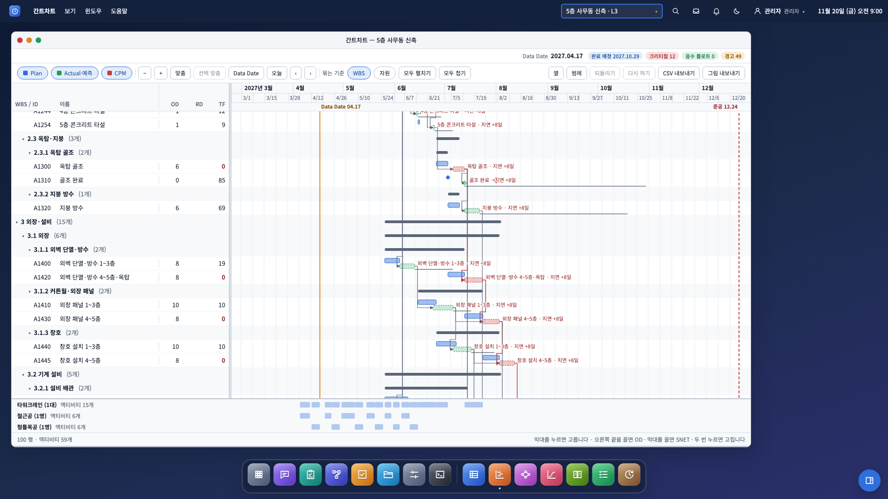
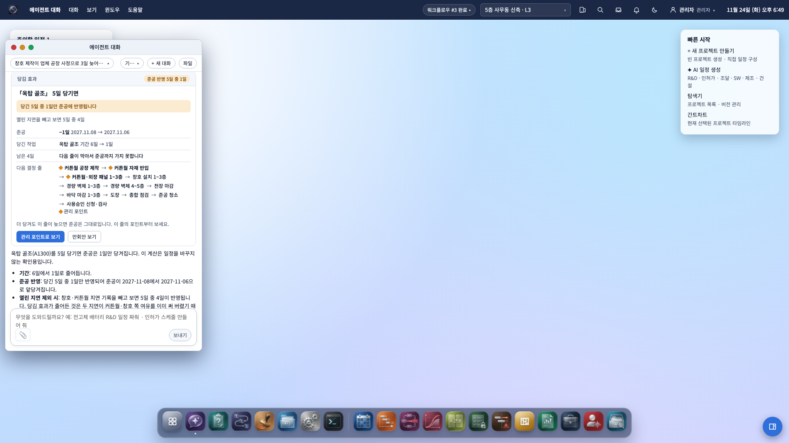
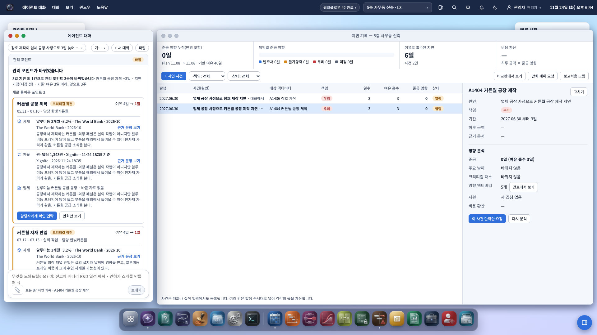
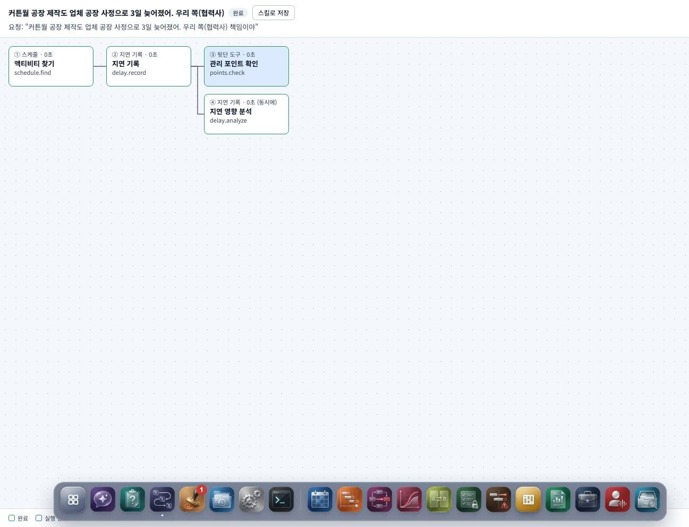
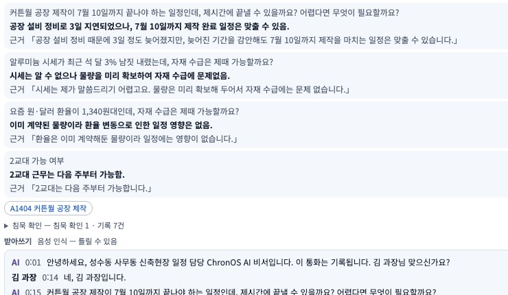
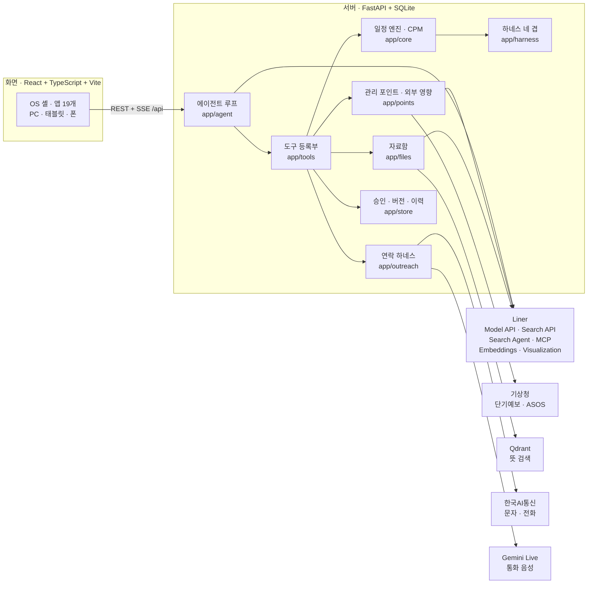
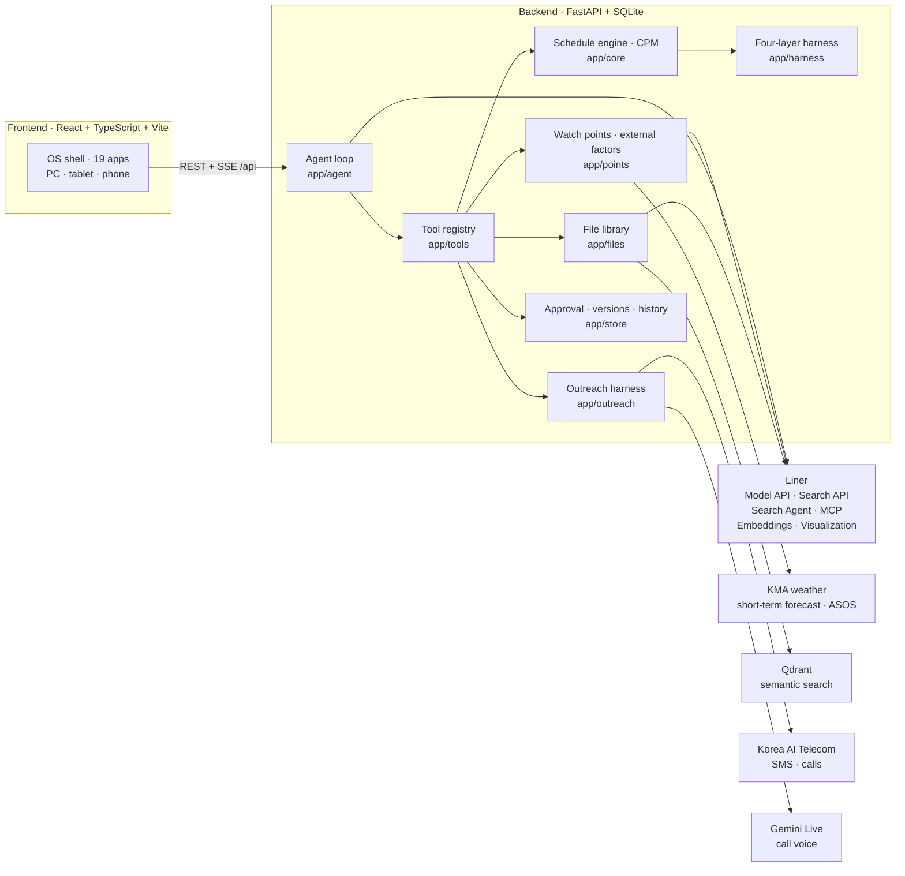

# ChronOS (크로노스)

> **일정이 바뀔 때마다 완료일정을 좌우하는 작업이 어디로 옮겨 갔는지 알려 주고, 그곳의 외부 영향을 찾아 담당자에게 먼저 묻는 일정 에이전트 OS.**

한국어 · [English](#chronos-english)

2026 라이너 해커톤 .EXE-THON 출품작이다. 대회 기간(2026.11.12~11.25)에 새로 만들었다.



## 소개

R&D 실증 과제·건설·생산 일정은 시험 결과·인허가·날씨·자재·사람·설비 때문에 매일 바뀌고, 변동이 쌓이면 완료일정(과제 종료·준공·납기)을 좌우하는 작업(크리티컬 패스) 자체가 다른 곳으로 옮겨 간다. 옮겨 간 것을 늦게 알면 이미 소용없어진 작업을 당기느라 돈과 사람을 쓴다.
ChronOS 는 맥 OS 모양의 웹 OS 이고, 에이전트 하나가 그 안의 앱(스케줄·간트·CPM·지연 기록·비교판·승인함·연락처 등 19개)을 도구로 열어 가며 일한다. 요청마다 워크플로우를 짜서 일정 생성, CPM 계산, 지연 영향, 만회안, 관리 포인트, 담당자 연락을 차례로 처리하고, 사람은 그 화면을 같이 보다가 승인함에서 결정한다.
**날짜는 코드가 계산한다.** LLM(Liner)은 구조(WBS·기간·선후 관계)를 내고, 근거를 찾고, 설명과 연락 글을 쓴다.

예시 일정 「5층 사무동 신축」·「가상 부품 공장 — 브래킷 BR-200 2만 개」와 연락처·협력사는 모두 가상이다. 대회 시연(기획서·영상)은 「가상 · 100kW급 수소 연료전지 발전 실증 과제」(연구 갈래와 인허가 갈래가 만나는 R&D 실증 일정)로 돌렸다.

## 빠른 시작 (한 줄 설치)

Docker·Node 없이 터미널 한 줄로 설치하고 띄운다. 준비물은 [uv](https://docs.astral.sh/uv/) 하나다(Python 3.13 은 uv 가 알아서 받는다).

```bash
# 준비: uv 설치 (맥·리눅스) — 설치 뒤 터미널을 새로 연다
curl -LsSf https://astral.sh/uv/install.sh | sh
# (Windows PowerShell)
powershell -ExecutionPolicy ByPass -c "irm https://astral.sh/uv/install.ps1 | iex"

# 설치하고 띄우기
uvx --from https://github.com/sohnjangho/chronos/releases/download/v0.1.0/chronos_backend-0.1.0-py3-none-any.whl chronos
```

- 처음 실행이면 **관리자 아이디**와 **비밀번호**(8자 이상, 입력은 보이지 않음, 두 번)를 묻는다. 다음부터는 같은 줄을 다시 치면 묻지 않고 바로 뜬다.
- 「ChronOS 주소: http://127.0.0.1:8210」 줄이 나오면 브라우저에서 **http://127.0.0.1:8210** 을 열고 그 계정으로 로그인한다. 끌 때는 터미널에서 Ctrl+C.
- 옵션은 명령 끝에 붙인다: `--port 8300`(포트) · `--data-dir 폴더`(데이터 위치) · `--qdrant-url http://127.0.0.1:6333`(뜻 검색). 전체는 `chronos --help`.
- 비밀번호를 잊었으면 같은 줄 끝에 `reset-password` 를 붙여 돌린다(아이디와 새 비밀번호를 묻는다. 서버를 끄지 않아도 된다):

  ```bash
  uvx --from https://github.com/sohnjangho/chronos/releases/download/v0.1.0/chronos_backend-0.1.0-py3-none-any.whl chronos reset-password
  ```
- 데이터는 `~/.chronos`(Windows 는 `%USERPROFILE%\.chronos`)에 둔다 — DB(`chronos.db`)와 비밀 열쇠(`secret_key`). 비밀 열쇠가 바뀌거나 없어지면 저장한 API 키를 풀 수 없으니 옮길 때는 폴더째 옮긴다.
- 받는 양: 설치 패키지 약 19MB + 필요한 Python 패키지(처음 한 번).
- 설치 파일을 먼저 받아 두고 쓰려면 [Releases](https://github.com/sohnjangho/chronos/releases) 페이지에서 `chronos_backend-0.1.0-py3-none-any.whl` 을 받아 그 폴더에서 `uvx --from ./chronos_backend-0.1.0-py3-none-any.whl chronos` 로 띄운다.

## 사용설명서

**[ChronOS 설치·사용설명서 (PDF, 22쪽)](docs/manual/ChronOS_설치_사용설명서.pdf)** — 설치·관리자 계정, LLM 연결, 작업별 모델 배정·임베딩, 외부 API, 문자·AI 전화 설정, Qdrant, 연결 확인, 처음 써 보기, 문제 해결을 그림과 함께 차례대로 따라 한다.

## 처음 설정

설치 직후에는 관리자 계정 말고는 아무것도 없다. 일정도, LLM 연결도, 임베딩 모델도, 외부 API 연결도 비어 있다. 키는 환경 변수가 아니라 **앱의 설정 화면**에서 넣고, 서버가 암호화해 저장하며 화면에는 끝 4자리만 보인다.

1. **설정 → LLM 연결 (필수)** — [+ 연결 추가] → 공급자 Liner → API 키 → [연결 테스트] → [저장]. 이 키 하나로 Model·Search·MCP·Premium Data·Visualization 이 모두 돈다.
2. **작업별 모델 배정 · 임베딩** — 처음 값이 들어 있어 그대로 둬도 된다(`liner-claude-router` 비용 우선·균형·품질 우선, 긴 문서 `liner-mark`, 임베딩 `openai/text-embedding-3-small`).
3. **설정 → 정보 API 연결 (권장)** — 기상청 날씨(공공데이터포털 키)와 공공 API(범용 · 빠른 채움). 없으면 그 근거만 빠진다.
4. **(선택) 설정 → 알림 연결** — 한국AI통신 문자 · Gemini Live AI 전화. 한 줄 설치에는 음성 SDK 가 들어 있지 않아 AI 전화는 「준비 안 됨」으로 보이고, 문자는 된다.
5. **(선택) Qdrant 뜻 검색** — `docker run -d --name chronos-qdrant -p 6333:6333 qdrant/qdrant:v1.13.4` 로 띄우고 명령 끝에 `--qdrant-url http://127.0.0.1:6333`. 끄면 낱말 검색으로 돈다.
6. **개발 콘솔 → 시스템 진단** — 「AI 모델 연결」이 정상인지 보고, 설정을 바꾼 뒤 [다시 점검].

다 됐으면 [+ 새 프로젝트] → 「AI 에이전트로 일정 생성」에 만들 일정을 한 문장으로 적는다(예: 「5층 사무동 신축 일정 짜 줘. 착공 2027년 3월 2일, 준공 2028년 2월 말」).

**사람 없이 나가는 연락은 없다.** 새 알림 연결은 시험 모드(허용 번호에만 연락)로 시작하고, 에이전트 권한은 「승인 받기」(에이전트는 초안만, 사람이 [보내기]·[전화 걸기])다.

각 단계의 화면과 문제 해결은 위 [사용설명서](docs/manual/ChronOS_설치_사용설명서.pdf)에 있다.

## 핵심 기능

- **에이전트 · 대화** — 요청마다 워크플로우를 그 자리에서 짜고 도구(`영역.동작` 꼴, 40여 개 — `backend/app/tools/`)를 부른다. 모자란 정보는 질문지로 묻고, 워크플로우 창에서 단계마다 도구·입력·출력·모델·비용을 보이며, 잘 된 순서는 [스킬로 저장]해 다시 쓴다. 에이전트가 여는 OS 창과 사람이 보는 창이 같다.
- **일정** — 대화 한 줄 → 질문지 → WBS·기간·선후 관계 초안 → 코드 계산·규칙 점검 → 어기면 다시 짜기 → 승인함. csv·tsv·xlsx 공정표 가져오기. 일정 엔진(`backend/app/core/`): 근무일 달력, CPM(FS/SS/FF/SF + lag), 자원 맞춤, 지연 영향, 만회안, 공정률. 화면: 스케줄 표, 간트, CPM 네트워크, 공정률, 비교판, 조건·규칙(하네스 네 겹).
- **관리 포인트 · 외부 영향** — 크리티컬이거나 여유가 적고 곧 시작하는 작업을 변동마다 다시 뽑아 알린다. 새 포인트에는 날씨(기상청), 금속 시세·환율(Liner Search Premium Data), 업계·규제·인허가 소식(Liner MCP)을 찾고, [근거 문장 보기]로 출처 문장과 링크를 보인다. 「이 작업을 n일 당기면」 준공에 반영되는 일수를 계산한다.
- **지연 기록 · 만회안 · 승인함** — 지연을 남기면 준공·크리티컬·자원 영향을 코드가 계산한다. 만회안은 코드가 만들고 Liner 가 설명·추천을 붙이며, 비교판에서 견주고 승인함에서 사람이 승인하면 새 버전이 된다(버전·이력·되돌리기).
- **연락 하네스** — 연락처, 문자, AI 전화 걸기·받기(한국AI통신 + Gemini Live). 통화가 끝나면 질문마다 답과 근거가 통화 카드에 남는다. 보내기·걸기는 모두 「나가는 문」 하나(시험 모드 → 차단·수신 거부 → 근무시간 → 상한 → 권한 → 중복)를 지난다. 카카오 알림톡은 연결만 있고 잠겨 있다.
- **현장 점검** — 현장 사진을 그림 읽기 모델로 읽어 진도율·근거·위험을 낸다. 읽지 못한 사진은 숫자 없이 「사람 판독 대기」로 넘긴다.
- **보고서 · 자료함** — 회사 양식을 배워 월간·분기 공정 보고서를 쓰고, 올린 문서를 낱말·뜻 검색(Liner 임베딩 + Qdrant)으로 찾는다.
- **개발 콘솔** — 실행 추적, 에이전트 구조, 도구 등록부, 하네스·차단 시험, 사용량, 시스템 진단.

## 화면

| 「당겨도 소용 있나」 — 당긴 5일 중 준공 반영 1일 | 관리 포인트가 바뀐 카드 · 외부 영향 · 지연 기록 |
|---|---|
|  |  |
| **워크플로우 — 에이전트가 짠 단계와 [스킬로 저장]** | **AI 전화 뒤 통화 카드 — 질문마다 답과 근거** |
|  |  |

## 구조



- **에이전트 루프**(`app/agent/loop.py`): Liner Model 이 도구를 고르고, 도구는 등록부(`app/tools/registry.py`)로만 불린다. 날짜가 필요하면 일정 엔진을 부르고, 엔진 결과는 하네스 네 겹(기본 규칙 · 분야 규칙 · 내 규칙 · 입력 조건)으로 점검한다.
- **외부 자료**: 금속 시세(The World Bank)·환율(Xignite)은 Liner Search 의 Premium Data 로, 근거 문장은 Liner Search Agent 로, 법령·업계 소식은 Liner MCP 로 받는다. 날씨는 기상청 공공데이터를 직접 부른다.
- **연락**: 문자·전화 통로는 한국AI통신, 실시간 통화 음성은 Gemini Live 다. 키는 모두 서버에서만 쓰고 화면에는 끝 4자리만 보인다.

## 안전 장치

- **날짜는 코드만 계산한다.** 만회안 설명에 날짜가 들어 있으면 버린다. 일정은 승인함에서 사람이 승인해야 바뀐다.
- **문자·전화는 기본이 시험 모드다.** 새 알림 연결은 시험 모드가 켜져 있어 허용 번호에만 나간다.
- **보내기·걸기는 기본이 「승인 받기」다.** 에이전트는 초안만 만들고 사람이 [보내기]·[전화 걸기]를 누른다. 「위임」으로 바꿔도 시험 모드·차단·수신 거부·근무시간·상한·중복 검사는 그대로 받는다. 받는 범위도 기본은 「받지 않음」이다.
- **전화번호는 모델·로그로 나가기 전에 지운다.** 모델 프롬프트·도구 결과·실행 추적·로그·오류 글은 한 곳(`app/outreach/redact.py`)을 지나며 번호를 `[번호]` 로, 키를 지운다.
- **키는 암호화해 저장한다.** Liner·한국AI통신·Gemini 키는 설정 화면에서 받아 Fernet 으로 암호화해 DB 에 두고(`app/security/crypto.py`), 응답·화면에는 끝 4자리만 보인다.
- **지어내지 않는다.** 외부 자료가 없으면 「외부 자료 없음」, 읽지 못한 현장 사진은 진도 숫자 없이 「사람 판독 대기」로 둔다. 코드가 점검하지 않은 조건은 「자동 점검 안 됨」으로만 보인다.
- 커밋 전 비밀 검사: `bash scripts/check_secrets.sh`(`scripts/check-local.sh` 에 포함).

## 기술 스택

| 영역 | 쓰는 것 |
|---|---|
| 서버 | Python 3.13 · FastAPI · SQLAlchemy + SQLite · httpx · cryptography(Fernet) · bcrypt · openpyxl · pypdf · qdrant-client |
| 화면 | React 19 · TypeScript · Vite · Zustand |
| AI · 외부 API | Liner Model API(`liner-claude-router` 등) · Liner Search API · Search Agent · MCP · Embeddings · Visualization · 기상청 공공데이터 · 한국AI통신 · Gemini Live |
| 검색 | Qdrant v1.13.4(뜻 검색, 끄면 낱말 검색만) |
| 설치 · 시험 · 배포 | uv(한 줄 설치) · pytest · ruff · Vitest · ESLint · Playwright · Docker compose |

## 폴더 구조

```
backend/app/
  agent/      에이전트 루프 · 일정 생성(생성-점검-고침) · 분야 합성
  tools/      에이전트 도구(영역.동작) · 등록부
  core/       일정 엔진: 달력 · CPM · 자원 · 지연 · 만회안 · 관리 포인트 · 공정률
  harness/    하네스 네 겹
  points/     관리 포인트 카드 · 외부 영향 · 근거 문장
  outreach/   연락 하네스 · 문자 · AI 전화 · 번호 지우기
  llm/        Liner 연결(Model · Search · Search Agent · MCP · 임베딩 · 시각화)
  files/      자료함: 읽기 · 분류 · 뜻 검색
  store/      DB 표 · 승인 · 버전 · 이력
  cli.py      chronos 명령(한 줄 설치)
frontend/src/ OS 셸(로그인 · 메뉴바 · 창 · Dock) · 앱 19개
scripts/      점검 · 시험 · 화면 빌드 · Qdrant 띄우기
docs/         설명서 · 설계 · 대회 문서 · 화면
```

## 다른 실행 방법

Docker compose(서버 8210 · 화면 5600 · Qdrant):

```bash
cp .env.example .env      # CHRONOS_ADMIN_ID · CHRONOS_ADMIN_PASSWORD · CHRONOS_SECRET_KEY 세 값을 바꾼다
docker compose up --build
docker compose exec backend python -m app.seed demo v3   # (선택) 가상 예시 일정 둘
```

개발용으로 맥에서 직접 띄우는 법, `.env` 값의 뜻, 연락처·문자·AI 전화 운영(시험 모드·받는 범위·상한·진단·수신 거부), Liner API 를 쓰는 곳은 **[docs/OPERATIONS.md](docs/OPERATIONS.md)** 에 있다.

## 시험

```bash
bash scripts/check-local.sh   # 비밀 검사 · 줄 수 · ruff · pytest · eslint · tsc · vitest · vite build
bash scripts/e2e-local.sh     # 끝에서 끝까지(Playwright, 1920×1080)
```

끝에서 끝까지 시험이 무엇을 도는지와 크로미움 준비는 [docs/OPERATIONS.md](docs/OPERATIONS.md#시험)에 있다.

---

# ChronOS (English)

> **A schedule-agent OS that, every time a schedule changes, tells you where the work that drives the completion date has moved, looks up the external factors affecting it, and asks the people in charge before it becomes a problem.**

[한국어](#chronos-크로노스) · English

Built for the 2026 Liner Hackathon .EXE-THON, from scratch during the contest period (Nov 12–25, 2026).


## Overview

R&D demonstration projects, construction, and production schedules change every day because of test results, permits, weather, materials, people, and equipment. As changes pile up, the critical path — the chain of work that sets the completion date (project end, handover, delivery) — itself moves elsewhere. Notice too late, and you spend money and people accelerating work that no longer matters.
ChronOS is a web OS styled like macOS. A single agent works inside it by opening its apps (schedule, Gantt, CPM, delay log, comparison board, approval inbox, contacts — 19 in total) as tools. For each request it plans a workflow and runs through schedule generation, CPM calculation, delay impact, recovery options, watch points, and contacting the people in charge, while a person watches the same screens and makes the call in the approval inbox.
**Dates are computed by code.** The LLM (Liner) proposes the structure (WBS, durations, dependencies), finds evidence, and writes explanations and messages.

The sample schedules "5-story office building" and "Virtual parts factory — 20,000 BR-200 brackets", as well as all contacts and partner companies, are fictional. The contest demo (proposal and video) runs on "Virtual · 100 kW hydrogen fuel-cell power demonstration project", an R&D schedule where a research track and a permitting track meet.

## Quick start (one-line install)

Install and run with a single terminal command — no Docker or Node needed. The only prerequisite is [uv](https://docs.astral.sh/uv/); uv fetches Python 3.13 on its own.

```bash
# Prerequisite: install uv (macOS / Linux) — open a new terminal afterwards
curl -LsSf https://astral.sh/uv/install.sh | sh
# (Windows PowerShell)
powershell -ExecutionPolicy ByPass -c "irm https://astral.sh/uv/install.ps1 | iex"

# Install and run
uvx --from https://github.com/sohnjangho/chronos/releases/download/v0.1.0/chronos_backend-0.1.0-py3-none-any.whl chronos
```

- On the first run it asks for an **admin ID** and a **password** (8+ characters, hidden, entered twice). After that, running the same line starts the server right away without asking.
- When the line `ChronOS 주소: http://127.0.0.1:8210` ("ChronOS address") appears, open **http://127.0.0.1:8210** in a browser and sign in with that account. Press Ctrl+C in the terminal to stop.
- Options go at the end of the command: `--port 8300` (port) · `--data-dir <folder>` (data location) · `--qdrant-url http://127.0.0.1:6333` (semantic search). See `chronos --help` for all of them.
- Forgot the password? Append `reset-password` to the same line. It asks for the ID and a new password; the server can keep running:

  ```bash
  uvx --from https://github.com/sohnjangho/chronos/releases/download/v0.1.0/chronos_backend-0.1.0-py3-none-any.whl chronos reset-password
  ```
- Data lives in `~/.chronos` (`%USERPROFILE%\.chronos` on Windows): the database (`chronos.db`) and the secret key (`secret_key`). If the secret key changes or is lost, stored API keys can no longer be decrypted, so move the folder as a whole.
- Download size: about 19 MB for the install package, plus the Python packages it needs (first run only).
- To use a downloaded file instead, get `chronos_backend-0.1.0-py3-none-any.whl` from the [Releases](https://github.com/sohnjangho/chronos/releases) page and run `uvx --from ./chronos_backend-0.1.0-py3-none-any.whl chronos` in that folder.

## Setup manual (Korean PDF)

**[ChronOS install & user manual (PDF, 22 pages, Korean)](docs/manual/ChronOS_설치_사용설명서.pdf)** — a step-by-step guide with screenshots: install and admin account, LLM connection, model per task and embeddings, external APIs, SMS and AI call setup, Qdrant, connection checks, first use, and troubleshooting.

## First-time setup

Right after install there is nothing but the admin account: no schedules, no LLM connection, no embedding model, no external API connections. Keys are entered in the **app's Settings screens**, not environment variables; the server stores them encrypted and the UI shows only the last 4 characters.

1. **설정 → LLM 연결 (Settings → LLM connection, required)** — [+ 연결 추가] (Add connection) → provider Liner → API key → [연결 테스트] (Test connection) → [저장] (Save). This one key powers Model, Search, MCP, Premium Data, and Visualization.
2. **작업별 모델 배정 · 임베딩 (Model per task · embeddings)** — defaults are pre-filled and fine as they are (`liner-claude-router` with cost / balanced / quality, `liner-mark` for long documents, `openai/text-embedding-3-small` for embeddings).
3. **설정 → 정보 API 연결 (Settings → Info APIs, recommended)** — KMA weather (data.go.kr service key) and public APIs (Generic · Quick fill). Without them, only that evidence is missing.
4. **(Optional) 설정 → 알림 연결 (Settings → Notification connection)** — Korea AI Telecom SMS and Gemini Live AI calls. The one-line install does not include the voice SDK, so AI calls show as 「준비 안 됨」 (not ready); SMS works.
5. **(Optional) Qdrant semantic search** — start it with `docker run -d --name chronos-qdrant -p 6333:6333 qdrant/qdrant:v1.13.4` and add `--qdrant-url http://127.0.0.1:6333` to the command. Without it, keyword search is used.
6. **개발 콘솔 → 시스템 진단 (Dev console → System diagnostics)** — check that 「AI 모델 연결」 (AI model connection) is OK, and press [다시 점검] (Re-check) after changing settings.

When you're done, click [+ 새 프로젝트] (New project) → 「AI 에이전트로 일정 생성」 (Generate schedule with the AI agent) and describe the schedule in one sentence (e.g. "Plan a 5-story office building. Start March 2, 2027, finish end of February 2028").

**Nothing goes out without a person.** New notification connections start in test mode (only allow-listed numbers are contacted), and agent permission starts at 「승인 받기」 (ask for approval): the agent only drafts, and a person presses [보내기] (Send) or [전화 걸기] (Call).

Screens for each step and troubleshooting are in the [setup manual](docs/manual/ChronOS_설치_사용설명서.pdf) above.

## Key features

- **Agent · chat** — plans a workflow on the spot for each request and calls tools (`area.action` form, 40+ — `backend/app/tools/`). Missing information is asked via a questionnaire; the workflow window shows each step's tool, input, output, model, and cost, and a good sequence can be saved as a skill ([스킬로 저장]) for reuse. The OS windows the agent opens are the same windows the person sees.
- **Scheduling** — one chat line → questionnaire → draft WBS, durations, dependencies → code calculation and rule checks → regenerate on violation → approval inbox. Imports csv / tsv / xlsx schedules. Schedule engine (`backend/app/core/`): working-day calendars, CPM (FS/SS/FF/SF + lag), resource leveling, delay impact, recovery options, progress. Views: schedule table, Gantt, CPM network, progress, comparison board, conditions & rules (four-layer harness).
- **Watch points · external factors** — re-selects, on every change, the tasks that are critical or have little float and start soon, and notifies you. For new points it looks up weather (KMA), metal prices and FX (Liner Search Premium Data), and industry / regulatory / permit news (Liner MCP), and [근거 문장 보기] (Show evidence) shows the source sentence and link. It also computes how many of "pull this task in by n days" actually reach the completion date.
- **Delay log · recovery · approval inbox** — when a delay is logged, code computes its effect on completion, the critical path, and resources. Code builds the recovery options and Liner adds explanations and a recommendation; compare them on the comparison board, and once a person approves in the inbox it becomes a new version (versions, history, rollback).
- **Outreach harness** — contacts, SMS, outbound and inbound AI calls (Korea AI Telecom + Gemini Live). After a call, the call card keeps each question's answer and the supporting words. Every send or call passes through a single "outbound gate" (test mode → block / opt-out → working hours → limits → permission → duplicates). KakaoTalk AlimTalk is wired up but locked.
- **Field checks** — reads site photos with a vision model to estimate progress, evidence, and risks. Photos it cannot read get no number and go to 「사람 판독 대기」 (awaiting human review).
- **Reports · file library** — learns a company template to write monthly / quarterly progress reports, and finds uploaded documents by keyword and semantic search (Liner embeddings + Qdrant).
- **Dev console** — run traces, agent structure, tool registry, harness / block tests, usage, system diagnostics.

## Screens

| "Does pulling in help?" — of 5 days pulled in, 1 reaches completion | Watch-point change card · external factors · delay log |
|---|---|
|  |  |
| **Workflow — steps the agent planned and [Save as skill]** | **Call card after an AI call — answer and evidence per question** |
|  |  |

## Architecture



- **Agent loop** (`app/agent/loop.py`): the Liner model picks tools, and tools are only called through the registry (`app/tools/registry.py`). When dates are needed it calls the schedule engine, and engine results are checked by the four-layer harness (base rules · domain rules · my rules · input conditions).
- **External data**: metal prices (The World Bank) and FX (Xignite) come from Liner Search Premium Data, evidence sentences from Liner Search Agent, and legal / industry news from Liner MCP. Weather is fetched directly from KMA public data.
- **Outreach**: SMS and calls go through Korea AI Telecom; real-time call voice is Gemini Live. All keys are used only on the server, and the UI shows only the last 4 characters.

## Safeguards

- **Only code computes dates.** A recovery-option explanation containing a date is discarded. A schedule changes only when a person approves it in the approval inbox.
- **SMS and calls default to test mode.** New notification connections start in test mode and only reach allow-listed numbers.
- **Sending and calling default to 「승인 받기」 (ask for approval).** The agent only drafts; a person presses [보내기] (Send) / [전화 걸기] (Call). Even with 「위임」 (delegate), test mode, blocks, opt-outs, working hours, limits, and duplicate checks still apply. The inbound scope also defaults to 「받지 않음」 (don't answer).
- **Phone numbers are removed before reaching the model or logs.** Model prompts, tool results, run traces, logs, and error messages all pass through one place (`app/outreach/redact.py`), which replaces numbers with `[번호]` and strips keys.
- **Keys are stored encrypted.** Liner, Korea AI Telecom, and Gemini keys are entered in Settings, encrypted with Fernet in the DB (`app/security/crypto.py`), and only the last 4 characters appear in responses and the UI.
- **No making things up.** With no external data it says 「외부 자료 없음」 (no external data); unreadable site photos stay at 「사람 판독 대기」 without a progress number; conditions the code does not check are shown only as 「자동 점검 안 됨」 (not auto-checked).
- Pre-commit secret scan: `bash scripts/check_secrets.sh` (included in `scripts/check-local.sh`).

## Tech stack

| Area | What we use |
|---|---|
| Backend | Python 3.13 · FastAPI · SQLAlchemy + SQLite · httpx · cryptography (Fernet) · bcrypt · openpyxl · pypdf · qdrant-client |
| Frontend | React 19 · TypeScript · Vite · Zustand |
| AI · external APIs | Liner Model API (`liner-claude-router`, etc.) · Liner Search API · Search Agent · MCP · Embeddings · Visualization · KMA public data · Korea AI Telecom · Gemini Live |
| Search | Qdrant v1.13.4 (semantic search; keyword-only when off) |
| Install · test · deploy | uv (one-line install) · pytest · ruff · Vitest · ESLint · Playwright · Docker compose |

## Folder layout

```
backend/app/
  agent/      agent loop · schedule generation (generate-check-fix) · domain synthesis
  tools/      agent tools (area.action) · registry
  core/       schedule engine: calendar · CPM · resources · delay · recovery · watch points · progress
  harness/    four-layer harness
  points/     watch-point cards · external factors · evidence sentences
  outreach/   outreach harness · SMS · AI calls · number redaction
  llm/        Liner connection (Model · Search · Search Agent · MCP · embeddings · visualization)
  files/      file library: reading · classification · semantic search
  store/      DB tables · approval · versions · history
  cli.py      chronos command (one-line install)
frontend/src/ OS shell (login · menu bar · windows · Dock) · 19 apps
scripts/      checks · tests · web build · Qdrant launcher
docs/         manual · design · contest documents · screenshots
```

## Other ways to run

Docker compose (backend 8210 · frontend 5600 · Qdrant):

```bash
cp .env.example .env      # change CHRONOS_ADMIN_ID · CHRONOS_ADMIN_PASSWORD · CHRONOS_SECRET_KEY
docker compose up --build
docker compose exec backend python -m app.seed demo v3   # (optional) two fictional sample schedules
```

Running directly on a Mac for development, what the `.env` values mean, outreach operations (test mode, inbound scope, limits, diagnostics, opt-out), and where the Liner APIs are used are in **[docs/OPERATIONS.md](docs/OPERATIONS.md)** (Korean).

## Tests

```bash
bash scripts/check-local.sh   # secret scan · line counts · ruff · pytest · eslint · tsc · vitest · vite build
bash scripts/e2e-local.sh     # end-to-end (Playwright, 1920×1080)
```

What the end-to-end tests cover and how to set up Chromium are in [docs/OPERATIONS.md](docs/OPERATIONS.md#시험) (Korean).
