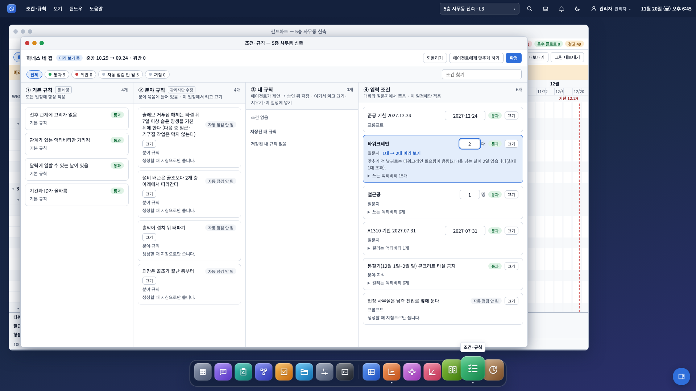
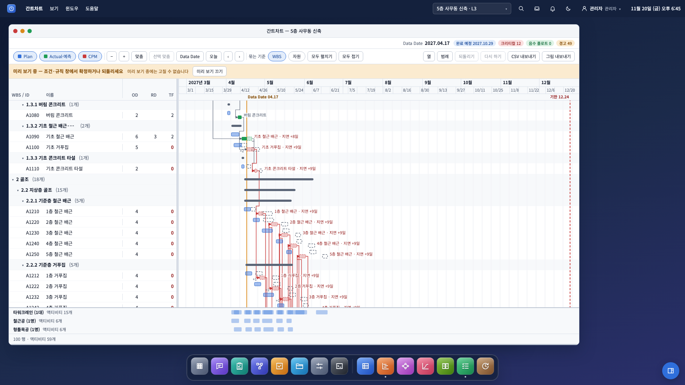
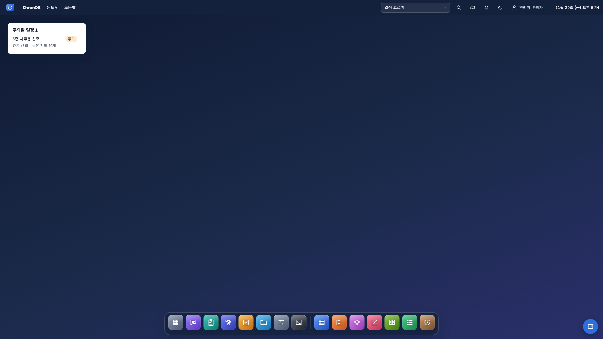

# ChronOS (크로노스)

일정을 만들고, 지키고, 고치는 에이전트 OS.
2026 라이너 해커톤 .EXE-THON 출품작이다. 대회 기간(2026.11.12~11.25)에 새로 만들었다.

- 화면은 OS 형태이고, 에이전트 하나가 전체를 맡는다. 에이전트는 요청마다 워크플로우를 짜고 일정 계산 도구를 차례로 쓴다.
- 일정은 대화로 만든다: 프롬프트 → 질문지 → WBS → 스케줄 → 간트 → 크리티컬 패스.
- 조건(하네스 네 겹)을 바꾸면 일정이 바로 다시 계산된다. 지연이 생기면 영향을 계산하고 만회안을 낸다.
- **날짜는 코드가 계산한다.** LLM은 구조(WBS·기간·선후 관계)를 내고 설명한다. 점검하지 않은 조건은 「자동 점검 안 됨」으로만 보인다.
- 두뇌는 **Liner Model API**, 근거 검색은 **Liner Search API·MCP** 다.


## 화면

| 조건·규칙에서 타워크레인 1대 → 2대 미리 보기 | 간트의 미리 보기 점선(옮기기 전 자리) |
|---|---|
|  |  |
| **대화로 일정 만들기 → 질문지** | **바탕화면 · 주의할 일정** |
|  |  |

화면은 `bash scripts/e2e-local.sh`(아래 「시험」)가 1920×1080 으로 찍어 `docs/demo/shots/` 에 둔다. 예시 일정 「5층 사무동 신축」은 가상이다.

## 구조

```
┌ OS 화면 (React · TypeScript · Vite) ─────────────────────────────────┐
│ 로그인 · 메뉴바 · 바탕화면 위젯 · 창 · Dock                              │
│ 시스템: 에이전트 대화 · 질문지 · 워크플로우 · 승인함 · 탐색기 · 설정 · 개발 콘솔 │
│ 업무:   스케줄 · 간트차트 · CPM · 공정률 · 비교판 · 조건·규칙 · 지연 기록    │
└──────────────────────┬──────────────────────────────────────────────┘
                       │ REST + SSE (/api)
┌ 서버 (FastAPI · SQLite) ▼────────────────────────────────────────────┐
│ 에이전트 루프(도구 호출) ── 도구 등록부(app/tools) ── 계산 코드(app/core)  │
│ 하네스 네 겹(app/harness): 기본 규칙 · 분야 규칙 · 내 규칙 · 입력 조건      │
│ 승인 판단 · 버전 · 변경 이력(app/store) · 분야 묶음(app/domains)           │
└──────────────────────┬──────────────────────────────────────────────┘
                       │ httpx (키는 서버에서만, 화면에는 끝 4자리)
          Liner Model API (두뇌) · Liner Search API · Liner MCP (근거)
```

## Liner API를 쓰는 곳

| 위치 | 하는 일 |
|---|---|
| `backend/app/llm/client.py` | Liner Model API(`https://platform.liner.com/api/v1/chat/completions`)를 부른다. 도구 호출·JSON 스키마 응답·`routing_strategy`. 호출마다 사용량을 `llm_calls` 에 남긴다(주고받은 글과 키는 남기지 않음). |
| `backend/app/llm/assignments.py` | **작업별 모델 배정 표.** 쓰임새마다 기본값이 있고, 화면에서 바꿀 수 있다. |
| `backend/app/programs/llm_settings/` | 「설정 > LLM 연결」 API: 연결 추가·연결 시험·모델 목록·배정 저장. 키는 Fernet 으로 암호화해 DB 에 둔다. |
| `backend/app/llm/search.py` | Liner Search API(`/tools/search/web`, `scholar`) — 근거 검색. |
| `backend/app/llm/mcp_client.py` | Liner MCP 의 `search_legal`·`search_business` — 법령·기업 근거 검색. |

작업별 기본 배정(`assignments.py`):

| 쓰임새 | 모델 · 라우팅 전략 | 부르는 곳 |
|---|---|---|
| light | `liner-claude-router` · cost | 조건 뽑기(`generate.extract_conditions`) |
| normal | `liner-claude-router` · balanced | 에이전트 대화 루프(`app/agent/loop.py`) |
| hard | `liner-claude-router` · quality | 일정 생성 WBS·초안·고침(`app/agent/generation_steps.py`), 단축안 설명 |
| longdoc | `liner-mark`(1M 컨텍스트) | 긴 문서용으로 둔 자리(지금은 부르는 곳 없음) |

실측 기록(모델·라우팅·도구 호출·JSON·그림 입력·MCP): `docs/dev-journal/2026-11.md`.

## 실행 (맥에서 직접)

준비: Python 3.13, Node 22 이상.

```bash
# 1) 서버 의존성(pyproject.toml 의 고정 버전 — Dockerfile 과 같은 방법)
python3.13 -m venv backend/.venv
backend/.venv/bin/python -c "import tomllib; p = tomllib.load(open('backend/pyproject.toml', 'rb'))['project']; print('\n'.join(p['dependencies'] + p['optional-dependencies']['dev']))" > backend/.venv/requirements.txt
backend/.venv/bin/pip install -r backend/.venv/requirements.txt

# 2) 화면 의존성
(cd frontend && npm ci)

# 3) 설정: .env.example 을 .env 로 복사하고 세 값을 바꾼다(관리자 아이디·비밀번호, 32자 이상 열쇠)
cp .env.example .env
set -a; source .env; set +a
export CHRONOS_DATA_DIR="$PWD/data"

# 4) (선택) 가상 예시 일정 넣기 — 여러 번 돌려도 같다(같은 이름의 일정만 지우고 다시 만든다)
(cd backend && .venv/bin/python -m app.seed demo)

# 5) 서버(8210)와 화면(5600)
(cd backend && .venv/bin/python -m uvicorn app.main:app --host 0.0.0.0 --port 8210) &
(cd frontend && CHRONOS_API_URL=http://127.0.0.1:8210 npx vite)
```

브라우저에서 `http://localhost:5600` → 첫 관리자 계정으로 로그인 → **설정 > LLM 연결**에 Liner API 키를 넣는다. 키는 화면에서만 받고, 응답에는 끝 4자리만 나온다.

Docker 로도 띄울 수 있다(선택): `.env` 를 만든 뒤 `docker compose up`.

## 시험

```bash
bash scripts/check-local.sh   # 비밀 검사 · 줄 수 · ruff · pytest · eslint · tsc · vitest · vite build
bash scripts/e2e-local.sh     # 끝에서 끝까지(Playwright, 1920×1080) — 처음 한 번: cd frontend && npx playwright install chromium
```

- 서버 끝에서 끝까지(`backend/tests/e2e/test_generate_flow.py`): 대화 → 질문지 → 생성(3회차 통과) → 승인 → 조건 미리 보기(크레인 2대) → 확정·승인 → 버전 1로 되돌리기. LLM 은 대본 가짜(`ScriptedLlm`).
- 화면 끝에서 끝까지(`frontend/e2e/demo.spec.ts`): `e2e-local.sh` 가 임시 폴더에 예시 일정을 넣고, 서버를 `CHRONOS_FAKE_LLM=1`(시험·시연 전용 가짜 Liner, `backend/app/llm/fake.py`)로 8310·5700 포트에 띄워 돈다. Liner 를 부르지 않고 `data/` 를 건드리지 않는다.

## 문서

| 위치 | 내용 |
|---|---|
| `docs/design/` | 설계 문서 |
| `docs/plans/` | 구현 계획서 |
| `docs/contest/` | 대회 규정 체크리스트, 제출물, 기획서 원고 |
| `docs/demo/` | 데모 영상 시나리오, 화면 캡처 |
| `docs/dev-journal/` | 개발 일지(Liner 실측) |

## 만드는 방법

AI 코딩 도구(Claude Code)를 써서 만들었다. 예시 자료(사람·회사·현장)는 전부 가상이다.
