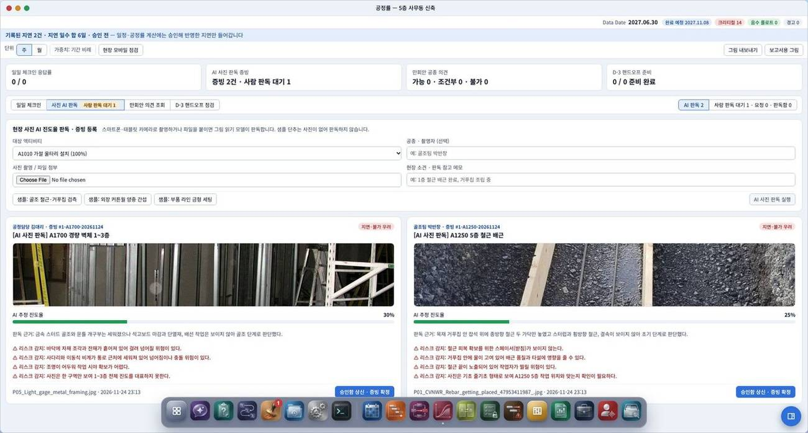
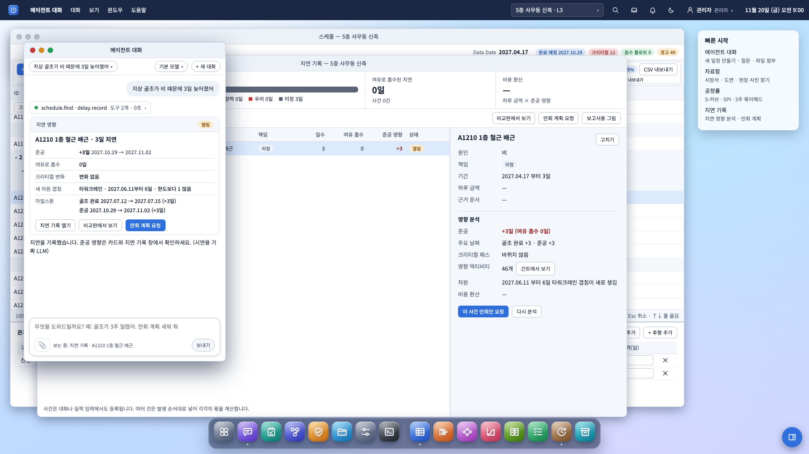
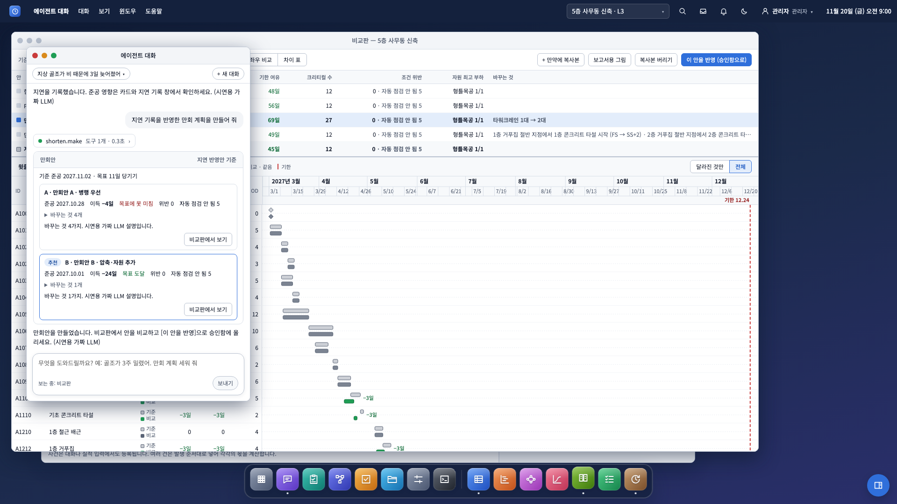
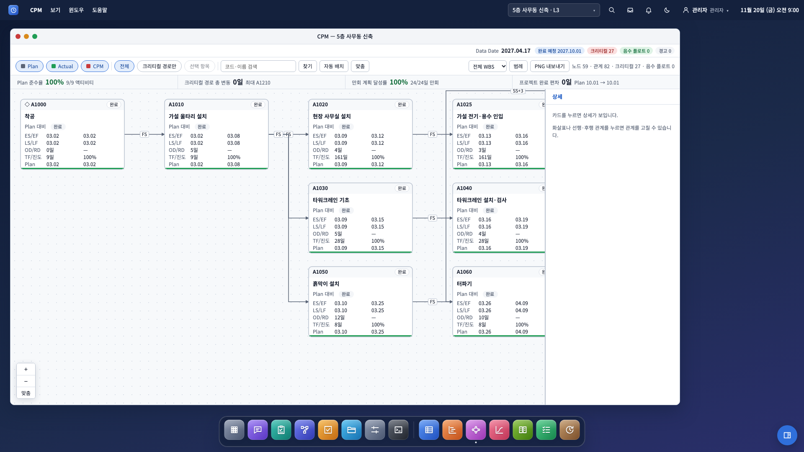
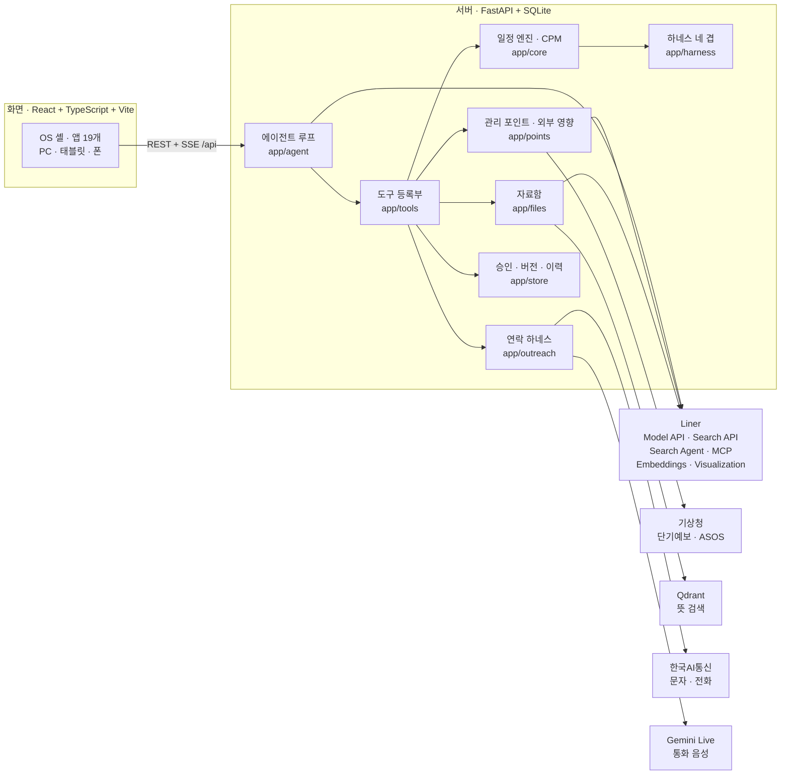

# ChronOS (크로노스)

> **일정이 바뀔 때마다 준공일을 좌우하는 작업이 어디로 옮겨 갔는지 알려 주고, 그곳의 위험을 찾아 담당자에게 먼저 묻는 일정 에이전트 OS.**

2026 라이너 해커톤 .EXE-THON 출품작이다. 대회 기간(2026.11.12~11.25)에 새로 만들었다.


## 소개

건설·생산 일정은 날씨·자재·사람·설비 때문에 매일 바뀌고, 변동이 쌓이면 준공(납기)을 좌우하는 작업(크리티컬 패스) 자체가 다른 곳으로 옮겨 간다. 옮겨 간 것을 늦게 알면 이미 소용없어진 작업을 당기느라 돈과 사람을 쓴다.
ChronOS 는 맥 OS 모양의 웹 OS 이고, 에이전트 하나가 그 안의 앱(스케줄·간트·CPM·지연 기록·비교판·승인함·연락처 등 19개)을 도구로 열어 가며 일한다. 요청마다 워크플로우를 짜서 일정 생성, CPM 계산, 지연 영향, 만회안, 관리 포인트, 담당자 연락을 차례로 처리하고, 사람은 그 화면을 같이 보다가 승인함에서 결정한다.
**날짜는 코드가 계산한다.** LLM(Liner)은 구조(WBS·기간·선후 관계)를 내고, 근거를 찾고, 설명과 연락 글을 쓴다.

예시 일정 「5층 사무동 신축」·「가상 부품 공장 — 브래킷 BR-200 2만 개」와 연락처·협력사는 모두 가상이다.

## 핵심 기능

**에이전트 · 대화**
- 에이전트 대화: 요청마다 워크플로우를 그 자리에서 짜고 도구(`영역.동작` 꼴, 40여 개 — `backend/app/tools/`)를 부른다. 한 턴 최대 12단계(`app/agent/loop.py`).
- 질문지: 모자란 정보는 바로 그리지 않고 질문지로 묻는다(`ask.questionnaire`). 답하지 않은 질문은 적어 둔 가정으로 간다.
- 워크플로우 창: 단계마다 쓴 도구·입력·출력·모델·비용을 보이고, 잘 된 순서는 [스킬로 저장]해 다음 요청에 다시 쓴다(`app/store/skills.py`).
- 에이전트가 OS 창을 직접 연다(`ui.open_window`) — 사람이 보는 창과 에이전트가 보는 창이 같다.

**일정**
- WBS 생성: 대화 한 줄 → 질문지 → WBS·기간·선후 관계 초안 → 코드 계산·규칙 점검 → 어기면 다시 짜기 → 승인함(`generate.run`). 처음 보는 분야는 분야 묶음을 즉석에서 합성한다(`app/agent/domain_synth.py`).
- 공정표 가져오기: csv·tsv·xlsx 를 읽어 빈칸만 묻고 초안으로 가져온다(`schedule.import`).
- 일정 엔진(`backend/app/core/`): 근무일 달력, CPM(FS/SS/FF/SF + lag, TF/FF), 자원 맞춤, 지연 영향, 만회안(병행·압축·자원 추가), 공정률.
- 화면: 스케줄 표, 간트(Plan·실적·크리티컬, 생산은 자원별 묶음), CPM 네트워크, 공정률, 비교판(여러 안을 같은 차트·요약표로), 조건·규칙(하네스 네 겹, 바꾸면 미리 보기).

**관리 포인트**
- 끝나지 않은 작업 가운데 크리티컬이거나 여유가 k 근무일 이하(기본 3일)이고 앞으로 w 주(기본 3주) 안에 시작하는 것(`app/core/points.py`). 변동마다 다시 뽑아 바뀌면 「관리 포인트가 바뀌었습니다」 카드로 알린다.
- 외부 영향: 새 포인트에만, 분야별로 켠 갈래를 찾는다 — 날씨(기상청), 금속 시세·환율(Liner Search Premium Data: The World Bank·Xignite), 업계 소식(Liner MCP). 자료가 없으면 숫자 없이 「외부 자료 없음」(`app/points/risk.py`).
- 근거 문장: [근거 문장 보기]를 누르면 Liner Search Agent 의 출처 문장과 링크를 보인다(`app/points/quotes.py`).
- 당겨도 소용 있나: 「이 작업을 n일 당기면」 준공에 반영되는 일수와 다음에 준공을 정할 줄을 계산한다(`points.accel_check`, `app/core/accel.py`).

**지연 기록 · 만회안 · 승인함**
- 대화나 지연 기록 창에서 지연을 남기면 준공·크리티컬·자원 겹침 영향을 코드가 계산한다(`delay.record`, `delay.analyze`).
- 만회안은 코드가 만들고 Liner 가 안마다 설명·추천을 붙인다(`shorten.make`). 비교판에서 견주고 승인함에서 사람이 승인하면 새 버전이 된다(버전·변경 이력·되돌리기).

**연락 하네스**
- 연락처(주소록·CSV), 문자, AI 전화 걸기·받기(한국AI통신 문자 REST·음성 SDK + Gemini Live). 에이전트가 물어볼 것과 말하지 않을 것을 써 오면 사람이 고친다.
- 통화가 끝나면 질문마다 답과 근거가 된 말, 받아쓰기가 통화 카드에 남는다.
- 보내기·걸기는 모두 「나가는 문」 하나를 지난다: 시험 모드 → 차단·수신 거부 → 근무시간 → 상한 → 권한 → 중복(`backend/app/outreach/`).
- 카카오 알림톡은 연결만 만들어 두었고 잠겨 있다(알림톡 요청은 문자로 나간다 — 아래 「카카오톡은 아직 쓰지 않는다」).

**현장 점검**
- 공정률 창의 일일 체크인과 현장 사진 AI 판독: 사진을 그림 읽기 모델로 읽어 진도율·근거·위험을 낸다. 읽지 못한 사진은 숫자를 붙이지 않고 「사람 판독 대기」로 넘긴다(`app/programs/progress/field.py`).

**보고서 · 자료함**
- 월간·분기 공정 보고서. 회사 양식을 배워 쓰고 블록으로 고친다(`report.learn_template`, `report.generate`).
- 자료함: 올린 문서를 읽고 분류해 낱말·뜻 검색(Liner 임베딩 + Qdrant)으로 찾는다(`backend/app/files/`).

**개발 콘솔**
- 실행 추적(턴마다 도구·모델·연락 판정), 에이전트 구조, 도구 등록부, 하네스·차단 시험(연락 하네스 격자), 사용량, 시스템 진단.

## 화면

| 「당겨도 소용 있나」 — 당긴 5일 중 준공 반영 1일 | 관리 포인트가 바뀐 카드 · 외부 영향 · 지연 기록 |
|---|---|
|  |  |
| **워크플로우 — 에이전트가 짠 단계와 [스킬로 저장]** | **AI 전화 뒤 통화 카드 — 질문마다 답과 근거** |
|  |  |
| **현장 사진 AI 판독 · 사람 판독 대기** | |
|  | |

<details>
<summary>끝에서 끝까지 시험이 찍은 화면 더 보기</summary>

| 조건·규칙에서 타워크레인 1대 → 2대 미리 보기 | 간트의 미리 보기 점선(옮기기 전 자리) |
|---|---|
|  |  |
| **대화로 일정 만들기 → 질문지** | **바탕화면 · 주의할 일정** |
|  |  |
| **대화로 지연 기록 → 지연 영향(코드 계산)** | **만회안 카드 → 비교판(같은 차트·여러 안 요약)** |
|  |  |
| **CPM 요약 줄(만회 계획 달성률)** | **생산 일정 간트 — 자원별 묶음·「프레스 작업 금지」 띠** |
|  |  |

이 화면들은 `bash scripts/e2e-local.sh`(아래 「시험」)가 1920×1080 으로 찍었다(`E2E_SHOTS_DIR` 로 `docs/demo/shots/` 를 줄 때). 장면 순서와 말은 `docs/demo/시나리오.md`.

</details>

## 구조



- **에이전트 루프**(`app/agent/loop.py`): Liner Model 이 도구를 고르고, 도구는 등록부(`app/tools/registry.py`)로만 불린다. 날짜가 필요하면 일정 엔진을 부르고, 엔진 결과는 하네스 네 겹(기본 규칙 · 분야 규칙 · 내 규칙 · 입력 조건)으로 점검한다.
- **외부 자료**: 금속 시세(The World Bank)·환율(Xignite)은 Liner Search 의 Premium Data(`include_knowledge`)로, 근거 문장은 Liner Search Agent 로, 법령·업계 소식은 Liner MCP 로 받는다. 날씨는 기상청 공공데이터를 직접 부른다.
- **연락**: 문자·전화 통로는 한국AI통신, 실시간 통화 음성은 Gemini Live 다. 키는 모두 서버에서만 쓰고 화면에는 끝 4자리만 보인다.

## 안전 장치

- **날짜는 코드만 계산한다.** 만회안 설명에 날짜가 들어 있으면 버린다. 일정은 승인함에서 사람이 승인해야 바뀐다.
- **문자·전화는 기본이 시험 모드다.** 새 알림 연결은 시험 모드가 켜져 있어 허용 번호에만 나간다(`app/store/tables_outreach.py` 의 `test_mode` 기본값).
- **보내기·걸기는 기본이 「승인 받기」다.** 에이전트는 초안만 만들고 사람이 [보내기]·[전화 걸기]를 누른다. 「위임」으로 바꿔도 시험 모드·차단·수신 거부·근무시간·상한·중복 검사는 그대로 받는다. 받는 범위도 기본은 「받지 않음」이다.
- **전화번호는 모델·로그로 나가기 전에 지운다.** 모델 프롬프트·도구 결과·실행 추적·로그·오류 글은 한 곳(`app/outreach/redact.py`)을 지나며 번호를 `[번호]` 로, 키를 지운다.
- **키는 암호화해 저장한다.** Liner·한국AI통신·Gemini 키는 환경 변수가 아니라 설정 화면에서 받아 Fernet 으로 암호화해 DB 에 두고(`app/security/crypto.py`), 응답·화면에는 끝 4자리만 보인다.
- **지어내지 않는다.** 외부 자료가 없으면 「외부 자료 없음」, 읽지 못한 현장 사진은 진도 숫자 없이 「사람 판독 대기」로 둔다. 코드가 점검하지 않은 조건은 「자동 점검 안 됨」으로만 보인다.
- 커밋 전 비밀 검사: `bash scripts/check_secrets.sh`(`scripts/check-local.sh` 에 포함).

## 기술 스택

| 영역 | 쓰는 것 |
|---|---|
| 서버 | Python 3.13 · FastAPI · SQLAlchemy + SQLite · httpx · cryptography(Fernet) · bcrypt · openpyxl · pypdf · qdrant-client |
| 화면 | React 19 · TypeScript · Vite · Zustand |
| AI · 외부 API | Liner Model API(`liner-claude-router` 등) · Liner Search API · Search Agent · MCP · Embeddings · Visualization · 기상청 공공데이터 · 한국AI통신 · Gemini Live |
| 검색 | Qdrant v1.13.4(뜻 검색, 끄면 낱말 검색만) |
| 시험 · 배포 | pytest · ruff · Vitest · ESLint · Playwright · Docker compose |

## 폴더 구조

```
backend/app/
  agent/      에이전트 루프 · 일정 생성(생성-점검-고침) · 분야 합성 · 승인 제안
  tools/      에이전트 도구(영역.동작) · 등록부
  core/       일정 엔진: 달력 · CPM · 자원 · 지연 · 만회안 · 관리 포인트 · 당김 효과 · 공정률
  harness/    하네스 네 겹
  points/     관리 포인트 카드 · 외부 영향 · 근거 문장
  outreach/   연락 하네스 · 문자 · AI 전화 · 번호 지우기
  notify/     알림 연결 진단 · 음성 진단
  llm/        Liner 연결(Model · Search · Search Agent · MCP · 임베딩 · 시각화)
  info/       기상청 · 범용 정보 API
  files/      자료함: 읽기 · 분류 · 조각 · 뜻 검색
  domains/    분야 묶음(건설 · 생산)
  programs/   앱별 API
  store/      DB 표 · 승인 · 버전 · 이력
  security/   로그인 · 암호화
  seed/       가상 예시 일정
frontend/src/
  os/         OS 셸(로그인 · 메뉴바 · 창 · Dock)
  programs/   앱 19개
scripts/      점검 · 시험 · Qdrant 띄우기
docs/         설계 · 계획 · 대회 문서 · 화면
```

## Liner API를 쓰는 곳

| 위치 | 하는 일 |
|---|---|
| `backend/app/llm/client.py` | Liner Model API(`https://platform.liner.com/api/v1/chat/completions`)를 부른다. 도구 호출·JSON 스키마 응답·`routing_strategy`. 호출마다 사용량을 `llm_calls` 에 남긴다(주고받은 글과 키는 남기지 않음). |
| `backend/app/llm/assignments.py` | **작업별 모델 배정 표.** 쓰임새마다 기본값이 있고, 화면에서 바꿀 수 있다. |
| `backend/app/programs/llm_settings/` | 「설정 > LLM 연결」 API: 연결 추가·연결 시험·모델 목록·배정 저장. 키는 Fernet 으로 암호화해 DB 에 둔다. |
| `backend/app/llm/search.py` | Liner Search API(`/tools/search/web`, `scholar`) — 근거 검색. 키는 서버에서 풀어 `x-api-key` 로만 보낸다. |
| `backend/app/tools/data/search_evidence.py` | 에이전트 도구 `evidence.search`: web·scholar 는 Search API, legal·business 는 MCP 로 찾아 근거로 보관한다(분야 검색이 실패하면 web 으로 한 번). |
| `backend/app/llm/mcp_client.py` | Liner MCP 의 `search_legal`·`search_business` — 법령·기업 근거 검색. |
| `backend/app/tools/respond/make_shortening.py` | 에이전트 도구 `shorten.make`: 만회안은 코드가 만들고, Model API(**hard**, strict JSON)로 안마다 설명과 추천을 받는다. 날짜가 든 설명은 버리고, 실패하면 코드 추천. |
| `backend/app/llm/visualization.py` | Liner Visualization API — 보고서용 그림. 그림 속 숫자를 표와 대조해 어긋나면 우리 그림으로. |

작업별 기본 배정(`assignments.py`):

| 쓰임새 | 모델 · 라우팅 전략 | 부르는 곳 |
|---|---|---|
| light | `liner-claude-router` · cost | 조건 뽑기(`generate.extract_conditions`) |
| normal | `liner-claude-router` · balanced | 에이전트 대화 루프(`app/agent/loop.py`) |
| hard | `liner-claude-router` · quality | 일정 생성 WBS·초안·고침(`app/agent/generation_steps.py`), 단축안 추천·설명(`app/tools/respond/make_shortening.py`) |
| longdoc | `liner-mark`(1M 컨텍스트) | 긴 문서용으로 둔 자리(지금은 부르는 곳 없음) |

실측 기록(모델·라우팅·도구 호출·JSON·그림 입력·MCP): `docs/dev-journal/2026-11.md`.

## 실행 (맥에서 직접)

준비: Python 3.13, Node 22 이상.

```bash
# 1) 서버 의존성(pyproject.toml 의 고정 버전 — Dockerfile 과 같은 방법)
python3.13 -m venv backend/.venv
backend/.venv/bin/python -c "import tomllib; p = tomllib.load(open('backend/pyproject.toml', 'rb'))['project']; print('\n'.join(p['dependencies'] + p['optional-dependencies']['dev']))" > backend/.venv/requirements.txt
backend/.venv/bin/pip install -r backend/.venv/requirements.txt

# 2) 화면 의존성
(cd frontend && npm ci)

# 3) 설정: .env.example 을 .env 로 복사하고 세 값을 바꾼다(관리자 아이디·비밀번호, 32자 이상 열쇠)
cp .env.example .env
set -a; source .env; set +a
export CHRONOS_DATA_DIR="$PWD/data"

# 4) (선택) 가상 예시 일정 둘 넣기 — 「5층 사무동 신축」(건설)·「가상 부품 공장 — 브래킷 BR-200 2만 개」(생산).
#    여러 번 돌려도 같다(같은 이름의 일정만 지우고 다시 만든다)
(cd backend && .venv/bin/python -m app.seed demo)   # demo v3 면 사무동 버전 3 까지

# (선택) 뜻 검색용 Qdrant(127.0.0.1:6333) — 띄우지 않으려면 .env 에 CHRONOS_QDRANT_URL= (빈 값)
bash scripts/qdrant-local.sh &

# 5) 서버(8210)와 화면(5600)
(cd backend && .venv/bin/python -m uvicorn app.main:app --host 0.0.0.0 --port 8210) &
(cd frontend && CHRONOS_API_URL=http://127.0.0.1:8210 npx vite)
```

브라우저에서 `http://localhost:5600` → 첫 관리자 계정으로 로그인 → **설정 > LLM 연결**에 Liner API 키를 넣는다. 키는 화면에서만 받고, 응답에는 끝 4자리만 나온다.

## 실행 (Docker compose)

```bash
cp .env.example .env      # 아래 세 값을 바꾼다
docker compose up --build # 서버 8210 · 화면 5600 · Qdrant(호스트 포트 없음, 저장 ./data/qdrant)
docker compose exec backend python -m app.seed demo v3   # (선택) 가상 예시 일정 둘
```

- **`.env` 에 넣는 값**(이름만 적는다 — 실제 값은 커밋하지 않는다): `CHRONOS_ADMIN_ID` · `CHRONOS_ADMIN_PASSWORD`(8자 이상, 72바이트 이하) · `CHRONOS_SECRET_KEY`(32자 이상, 예: `openssl rand -hex 32`). 예시 값 그대로면 서버가 뜨지 않는다. `CHRONOS_SECRET_KEY` 는 로그인 토큰 서명과 저장 키 암호화(이 값에서 SHA-256 으로 Fernet 열쇠를 유도)에 쓰여, 바꾸면 저장해 둔 API 키를 풀 수 없다.
- **Liner API 키는 환경 변수가 아니다.** 로그인 뒤 **설정 > LLM 연결**에 넣는다(암호화해 DB 에 두고 화면에는 끝 4자리만).
- **뜻 검색**: compose 가 Qdrant `v1.13.4` 를 함께 띄우고 서버에 `CHRONOS_QDRANT_URL=http://qdrant:6333` 을 준다. 임베딩은 `openai/text-embedding-3-small` 을 Liner 연결(OpenAI 호환 `/embeddings`)로 부른다. `CHRONOS_QDRANT_URL` 이 빈 값이면 뜻 검색만 끄고 낱말 검색으로 돈다. 개발 콘솔 → 시스템 진단 → 「벡터 검색 서버」에서 연결을 본다.
- **예시 일정**: `demo v3` 는 「5층 사무동 신축」 버전 3(6월 말 실적 · 커튼월·창호 조달 줄)과 「가상 부품 공장 — 브래킷 BR-200 2만 개」를 넣는다. 여러 번 돌려도 같다. `demo` 만 주면 사무동은 버전 2 까지.
- **문자·전화는 기본이 시험 모드다.** 새 알림 연결은 시험 모드가 켜져 있어 허용 번호에만 나가고, 에이전트 권한도 처음은 「승인 받기」라 사람이 [보내기]·[전화 걸기]를 눌러야 나간다(아래 「연락처 · 문자 · AI 전화」). 확인·시연용 사본은 `.env` 에 `CHRONOS_OUTREACH_WORKER=off` 로 띄운다.

## 연락처 · 문자 · AI 전화 — 운영 (계획 4)

협력사 사람에게 문자를 보내고 AI 음성 에이전트가 전화를 건다. 제공사는 한국AI통신(문자는 REST, 전화는 음성 SDK), 음성 모델은 구글 Gemini Live 다.
**보내기·걸기는 모두 「나가는 문」 하나를 지난다** — 시험 모드 → 차단·수신 거부 → 근무시간 → 상한 → 권한 → 중복 차례로 보고, 걸리면 보내지 않고 까닭을 남긴다.
예외는 하나뿐이다: 연결 진단·음성 진단에서 관리자가 명시한 시험 문자·시험 전화(첫 허용 번호로만).

### 키 넣는 차례

키는 모두 앱의 **설정 → 알림 연결** 화면에 넣는다. 터미널 스크립트는 쓰지 않는다. 키는 암호화해 저장하고 화면에는 끝 4자리만 보인다. Account ID 는 식별자라 평문으로 두되 화면에서는 가리고 로그에서는 지운다.

1. **[+ 연결 추가]** — 이름 · 주소(기본 `https://api.koreaaitel.com`) · API Key · Account ID → [저장하고 연결 테스트]. 주소를 바꾸면 키를 다시 넣는다.
2. **발신번호** — 제공사에 승인된 번호 가운데 고른다(심사 중인 번호는 쓸 수 없다).
3. **허용 번호** — 새 연결은 시험 모드가 켜져 있다. 본인 휴대전화를 허용 번호로 넣는다(아래 「시험 모드」).
4. **[연결 진단]** — 아래 「연결 진단 · 음성 진단」.
5. **AI 전화** — 같은 화면 아래 「AI 전화」 칸: 공급자 구글(Gemini Live) · 음성 모델 키 · 모델(목록에서 고름, 기본 `gemini-3.8-live`) · AI 전화 번호(070, 비우면 문자 발신번호를 쓴다) → 저장 → [음성 진단].
6. **[음성 고르기]** — 음성 이름을 손으로 넣는다(아래). 넣은 뒤 음성 진단을 한 번 더 돌린다.
7. 마지막으로 **받는 범위**와 **에이전트 권한**(위임)을 정한다. 둘 다 처음은 가장 안전한 값(「받지 않음」 · 「승인 받기」)이다.

LLM 키(Liner)는 이와 따로 **설정 → LLM 연결**에 넣는다. 에이전트 대화·문자 답·통화 요약이 이 연결을 쓴다.

**구글 키 주의.** 실시간 음성(Live)은 구글 API 의 `v1alpha` 판에만 열려 있다 — 앱에는 이미 그렇게 맞춰 두었다(`backend/app/outreach/voice/numbers.py` 의 `GOOGLE_LIVE_API_VERSION`). 키는 **Google AI Studio 에서 만든 Gemini API 키**여야 하고, 그 키의 프로젝트 모델 목록에 Live 모델이 있어야 한다. 화면이 걸기 전에 목록을 읽어 확인한다:
- 「구글이 이 키로 Gemini API 를 쓰지 못하게 합니다(권한 없음)」 → AI Studio 에서 만든 키로 바꾸거나 그 프로젝트에서 Generative Language API 를 켠다.
- 「이 키의 프로젝트에서는 실시간 음성(Live) 모델을 쓸 수 없습니다」 → 결제(유료 등급)를 켠 뒤 다시 확인한다.

두 경우 모두 진단·시험 전화는 걸기 전에 멈춘다(전화가 걸렸다 끊기지 않는다).

**무료 Gemini 등급 주의.** 무료 등급 키로 한 통화의 내용은 구글의 제품 개선에 쓰일 수 있다. 실제 협력사와 통화하기 전에 유료 등급 키로 바꾼다. 그 전에는 본인 번호로만 시험한다.

**음성 SDK 설치는 PM 이 승인한 뒤에 한다.** 지금 `backend/.venv` 에 `koreaaitel[agent,gemini]==0.78.0` 이 깔려 있다(11-23 PM 승인, import 이름은 `clawops`). 새 환경에 깔 때도 PM 이 정한다: `pyproject.toml` 의 `voice` 묶음. 없어도 앱은 뜨고, 전화만 「준비 안 됨」이 된다.

### 시험 모드 · 허용 번호

- 새 연결은 **시험 모드 켬**이다. 시험 모드에서는 허용 번호에만 문자가 나가고 전화가 걸린다. 허용 번호가 아닌 사람에게 보내면 그 줄은 **「시험 모드로 보내지 않음」**으로 남고(까닭 「시험 모드라 허용한 번호에만 연락합니다」) 아무것도 나가지 않는다.
- 들어오는 쪽도 같다: 시험 모드에서는 허용 번호의 문자·전화만 응대하고 나머지는 기록만 남긴다.
- 허용 번호는 휴대전화 번호로 넣는다. 진단의 실제 문자·전화는 **목록의 첫 허용 번호**로만 간다.
- 시험 모드를 끄면 확인 칸이 한 번 더 묻는다. 끄면 주소록의 실제 번호로 나간다.

### 위임을 켜기 전에 볼 것

권한은 채널마다(문자 · 전화) 「승인 받기」 또는 「위임」이다. 기본은 「승인 받기」 — 에이전트는 초안만 만들고 사람이 [보내기]·[전화 걸기]를 누른다. 「위임」이면 에이전트가 사람 확인 없이 보내고 건다. 위임이어도 시험 모드·차단·수신 거부·근무시간·상한·중복 검사는 그대로 받는다. 카카오톡 권한은 잠겨 있다(아래).

켜기 전에:
1. 시험 모드인지, 허용 번호가 본인 번호뿐인지.
2. **상한** 숫자(아래)가 현장에 맞는지 — 특히 한 사람 하루 문자 5건 · 전화 2통, 통화 5분.
3. 연락처의 근무시간 · 언어 · 성별(반대 성별 음성을 고른다).
4. 개발 콘솔 → 하네스·차단 시험 → 「연락 하네스」 격자 **[전부 돌리기]** 가 「통과 93 · 실패 3」인지. 실패 셋(S-13 두 칸 · S-20 받기)은 「하네스 갈라짐」 표시가 붙은 칸이다 — 알려진 한계(아래)다. 그 밖의 칸이 실패하면 켜지 않는다.
5. 개발 콘솔 → 실행 추적 → 요청 고르기 → 「연락」에서 최근 문자·통화의 문 판정이 기대와 같은지.

위임 중에도 자동 답이 뒤 확인(근거 없는 날짜·금액·범위 밖 이름)에 걸리면 보내지 않고 초안으로 둔다. 승인하지 않은 자동 답 초안도 자동 답 상한에 든다.

### 받는 범위 — 전화와 문자를 함께

설정 → 알림 연결 → 「받는 범위 · 차단」. **한 설정이 걸려 오는 전화와 들어오는 문자에 같이 걸린다.** 기본은 **「받지 않음」**이다.

| 받는 범위 | 들어온 문자 | 걸려 온 전화 |
|---|---|---|
| 받지 않음(기본) | 대화에 기록만 남긴다(응대 없음) | 받지 않고 기록만 |
| 주소록에 있는 번호만 | 연락처에게 자동 답 — 「승인 받기」면 점선 말풍선의 초안(「들어온 문자에 대한 답 초안」)을 사람이 [보내기] | 연락처의 전화를 AI 가 받는다 |
| 모두 받기 | 모르는 번호에는 일정 내용 없는 고정 안내 「담당자가 확인 후 연락드리겠습니다.」(번호당 하루 1번 · 모두 하루 10건) | 모르는 번호 전화도 받되 메모만(2분 · 한 시간 6통까지) |

- 우리가 보낸 문자에 온 답은 그 요청에 이어 대화에 보인다(「↩ … 보낸 글에 대한 답」).
- 모르는 번호의 문자·전화는 어느 프로젝트에도 묶지 않고 연락처 창의 「모르는 번호 · 대표번호」 묶음에 같게 보인다. [주소록에 넣기] · [차단](관리자)을 거기서 한다.
- 받은 전화에서 상대가 알린 지연·문제는 「확인할 보고 n」으로 쌓인다. 일정은 바뀌지 않는다 — 사람이 보고 지연 기록을 만든다.
- **음성 진단을 돌리는 동안은 받는 통화 듣기를 잠깐 멈추고** 진단이 끝나면 다시 붙는다. 그 사이 다른 번호의 전화는 「음성 진단 중이라 받지 못했습니다」 부재중으로 남는다.
- 동시 통화는 1통이다. 통화 중에 걸려 온 전화는 받지 않고 기록한다.
- AI 전화 번호 하나에는 서버 하나만 붙는다. 쓰는 앱과 시험용 사본을 같은 070 번호로 함께 띄우면 서로 연결을 빼앗는다.

### 앱이 꺼진 동안의 전화

앱(서버)이 다시 켜지면 꺼져 있던 동안 — 그리고 받는 범위가 「받지 않음」이던 동안 — 걸려 온 전화를 제공사의 통화 목록에서 읽어 **「받지 못한 전화(부재중)」로 채운다. 이 부재중에는 회신 문자를 보내지 않는다** — 사람이 보고 판단한다. 음성 진단의 거절 시험(P14) 통화는 채우지 않는다. 문자는 마지막으로 읽은 자리를 DB 에 두고 있어 다시 켜면 그 뒤에 온 것을 읽어 온다.

문자 일꾼과 통화 일꾼은 `CHRONOS_OUTREACH_WORKER` 가 비었거나 `on` 일 때 서버와 함께 뜬다. `off` 면 예약 문자·상태 조회·들어온 문자·받는 통화가 모두 멈추고, 사람의 [보내기]도 「통로 준비 안 됨」이 된다. 실제 자료의 복사본으로 띄우는 확인·시연용 서버는 꼭 `off` 로 띄운다.

### 카카오톡은 아직 쓰지 않는다

연결만 만들어 두었다. 알림톡은 나가지 않는다 — 입력창의 「카카오톡」은 잠겨 있고(「카카오톡은 채널·문안 승인 뒤 쓸 수 있습니다 — 지금은 문자로 보냅니다」), 알림톡 요청은 문자로 나간다. 나중에 켜는 차례(설정 → 알림 연결 → 「카카오톡 채널과 문안」에도 같은 글이 있다):

1. 카카오톡 비즈니스 채널을 만든다 — 사업자 인증이 필요할 수 있다.
2. 한국AI통신 콘솔에서 채널을 연결한다(채널 검색용 ID와 채널 관리자 휴대전화로 온 인증번호).
3. 알림톡 문안을 등록하고 카카오 검수를 받는다 — 승인 전에는 보낼 수 없다.
4. 설정에서 [채널·문안 다시 읽기]를 누르고, 승인된 문안을 쓰는 곳에 잇는다.

**카카오톡으로 온 답은 받을 수 없다. 답은 문자로 받는다** — 문안에 「문자로 답해 주세요」 줄을 넣는다. 채널이 생기면 제공사 문서에서 채널·문안 목록의 응답 꼴을 확인한 뒤 코드의 `KAKAO_LISTING_CONFIRMED` 를 켠다(개발 작업).

### 상한 — 고치는 곳 둘, 값은 하나

상한은 코드 상수가 아니라 설정이다. **설정 → 알림 연결 → 「상한」 묶음**과 **개발 콘솔 → 하네스·차단 시험 → 「연락 하네스」 → 「운영 상한」** 두 곳에서 고칠 수 있고, 둘은 같은 API(`/api/notify/connections/{id}/limits`)·같은 값이다. 한 곳에서 고치면 다른 곳도 바뀐다. 격자의 칸은 이 값이 아니라 대본이 적어 둔 상한으로 돈다.

| 묶음 | 칸(기본값) |
|---|---|
| 문자 | 하루 문자 50건 · 한 사람 하루 문자 5건 |
| 전화 | 하루 전화 10통 · 한 사람 하루 전화 2통 · 최대 통화 시간 300초 |
| 자동 답 | 한 번호 한 시간 5번 · 하루 20번 · 답 유예 30분(상대가 먼저 보낸 뒤 이 시간 안의 답은 근무시간 밖이어도 보냄) |
| 모르는 번호 | 통화 시간 120초 · 전화 한 시간 6통 · 안내 한 번호 하루 1번 · 안내 모두 하루 10건 |
| 잦은 연락 | 10분에 5번 넘게 들어오면 기록만(전화·문자 따로 셈) |

근무시간이 비어 있는 연락처는 달력의 근무일 08:00~18:00 을 쓴다. 근무시간 밖의 문자는 다음 근무 시작에 예약되고, 전화는 걸지 않고 [다음 근무 시작에 예약]을 눌러야 예약된다.

### 연결 진단 · 음성 진단 쓰는 법

**연결 진단**(알림 연결 카드의 [연결 진단]) — 저장된 키로 돈다. 줄마다 정상 · 실패 · 건너뜀과 쉬운 까닭이 나온다.

| 걸음 | 보는 것 |
|---|---|
| P1 | 인증 + 발신번호 목록(고른 발신번호가 승인됐는가) |
| P2 | 시험 문자 1건 보내기 — **「실제 문자 1건 보내기」 스위치를 켰을 때만**(또는 [시험 문자]), 확인 창에서 본 첫 허용 번호로만 |
| P3 | 보낸 시험 문자의 상태 |
| P4 | 받은 문자 목록 |

실제 문자는 요금이 든다. 보냈는지 모를 때(「확인 필요」)는 10분 안에 다시 보내지 않게 막고, 따로 확인해야 다시 나간다.

**음성 진단**(「AI 전화」 칸) — 단추 셋으로 나눠 돈다(한 번에 돌리면 9분이 넘을 수 있다).

| 단추 | 걸음 | 전화 |
|---|---|---|
| [음성 진단] | P5 SDK·플랫폼 연결 · P9 넣은 음성 이름 확인 · P11 AI 전화 번호를 에이전트에 묶기 | 걸지 않음 |
| [시험 전화] | P6 한국어 시험 통화 · P7 받아쓰기 · P8 도구 호출 · (고르면) P10 영어 첫마디 | 첫 허용 번호로 1통(영어까지 2통) |
| [받는 통화 확인] | P12 걸려 온 통화 받기 · P13 건 번호 읽기 · P14 받지 않고 거절 | 본인이 AI 전화 번호로 건다 |

실제 전화는 「실제 통화 포함」 스위치를 켰을 때만 걸리고, 한 번 건 뒤 스위치는 저절로 꺼진다(다시 켜야 한다). 진단 전화의 첫마디는 「…연결 진단 전화입니다. 이 통화는 녹음하지 않습니다.」다.

**음성 이름은 손으로 넣는다.** 음성 SDK 가 음성 목록·샘플을 주지 않는다. 그래서 P9 는 목록 대신 넣은 이름마다 전화 없이 음성 세션을 열어 보고 닫는다. [음성 고르기]에서 「남성 연락처에게 걸 때 · 여성 연락처에게 걸 때 · 성별 모름」 칸(언어별로 더할 수 있음)에 공급자 안내에 있는 음성 이름을 그대로 쓴다. 비우면 기본 음성(Gemini `Kore`). **이름을 바꾼 뒤에는 [음성 진단]을 다시 돌려 P9 줄을 본다** — 없는 이름이면 그 칸을 쓰는 전화는 상대가 받은 뒤 끊긴다. 소리를 들어 보려면 [시험 전화]를 쓴다. P9 의 이름 확인은 가짜 SDK 로만 시험했고 실제 공급자로는 아직 확인하지 않았다.

### 수신 거부 — 문자와 전화

수신 거부는 **번호에 붙는다** — 그 번호가 있는 모든 프로젝트에서 막히고, 사람의 번호를 바꿔도 옛 번호는 계속 막힌다.

**코드가 잡는 것**(모델에 맡기지 않음):
- 문자·통화의 「수신거부」(+ 「요」「합니다」「해주세요」「부탁드립니다」「원해요」「신청」 같은 맺음말) — 앞에 「네」「예」 같은 대답 말 하나는 붙어도 된다(「네, 수신거부요」). 물음(「수신거부요?」)과 부정(「수신거부 아닙니다」)은 아니다.
- 문장 전체가 「(앞으로·다시는·이제…) 전화/연락/문자 (하지/주지) 마세요」인 것. 남 얘기(「소장님한테 전화하지 마세요」)나 때를 말한 것(「지금은 연락 주지 마세요」 — 글 어디에든 「지금·오늘·내일·나중」 같은 말)이 있으면 아니다.
- 문자 전체가 「그만」 또는 「stop」뿐인 것(문자만 — 통화에서는 「그만」이 너무 자주 나와 쓰지 않는다).
- 문자는 받는 범위·상한보다 먼저 본다(받는 범위가 「받지 않음」이어도 표시한다). 주소록·내부 계정 번호에는 확인 문자 「수신 거부로 처리했습니다. 더 이상 연락드리지 않습니다.」를 한 번 보낸다(권한을 따른다 — 「승인 받기」면 초안). 주소록에 없는 번호에는 표시만 하고 문자는 보내지 않는다.
- 통화는 그 말을 들으면 표시하고 바로 끊는다. 통화 중 표시가 실패해도 통화 뒤 받아쓰기를 다시 보고 한 번 더 표시한다.

**모델에 맡기는 것**: 위 꼴이 아닌 거절(돌려 말한 것)은 음성·문자 에이전트의 `mark_do_not_contact` 도구에 기댄다. 알려진 틈 — 「전화하지 마세요. 내일 다시 얘기해요」는 때 말이 있어 코드가 표시하지 않는다(모델 도구만 남음). 거꾸로 「소장님은 바빠요. 전화하지 마세요.」는 수신 거부로 본다(맨 문장 「전화하지 마세요」).

**잘못 걸린 수신 거부 풀기**: 연락처 → 그 사람 → [고치기] → 「수신 거부」 끄기 → 확인 창 「수신 거부 풀기」. **관리자만** 풀 수 있고(켜기는 누구나), 풀면 그 번호가 있는 모든 프로젝트에서 풀린다.

## 시험

```bash
bash scripts/check-local.sh   # 비밀 검사 · 줄 수 · ruff · pytest · eslint · tsc · vitest · vite build
bash scripts/e2e-local.sh     # 끝에서 끝까지(Playwright, 1920×1080)
```

처음 한 번 크로미움을 `frontend/.playwright-browsers` 에만 받는다(맥 전체 캐시를 건드리지 않음 — 스크립트도 같은 자리를 쓴다):

```bash
cd frontend && PLAYWRIGHT_BROWSERS_PATH="$PWD/.playwright-browsers" PLAYWRIGHT_SKIP_BROWSER_GC=1 npx playwright install chromium
```

단계 화면은 기본으로 임시 폴더에 찍힌다. 위의 캡처를 다시 찍을 때만 시험 파일 하나씩(씨앗 그대로에서) `E2E_SHOTS_DIR="$PWD/docs/demo/shots" bash scripts/e2e-local.sh e2e/demo.spec.ts` · `… e2e/bundle2.spec.ts`. 둘을 한 번에 돌리면 묶음 2 가 먼저 돌아 일정을 바꾸므로(끝에 사무동 일정을 버전 2 내용으로 되돌린다) 묶음 1 화면이 씨앗 그대로와 달라질 수 있다.

- 서버 끝에서 끝까지(`backend/tests/e2e/test_generate_flow.py`): 대화 → 질문지 → 생성(3회차 통과) → 승인 → 조건 미리 보기(크레인 2대) → 확정·승인 → 버전 1로 되돌리기. LLM 은 대본 가짜(`ScriptedLlm`).
- 서버 끝에서 끝까지 묶음 2(`backend/tests/e2e/test_bundle2_flow.py`): 씨앗 두 일정 → 대화 "지상 골조가 비 때문에 3일 늦어졌어"(고른 작업 A1210) → `schedule.find` → `delay.record`(준공 +3일) → "만회 계획 만들어 줘" → `shorten.make`(목표 도달 안 있음·위반 0) → 추천 안 제출·승인 → 버전 3·지연 반영됨 → 공정률 · 개발 콘솔 두 턴 · 생산 일정은 자원별 간트. LLM 은 앱 안 가짜(`app/llm/fake.py` 의 묶음 2 대본).
- 화면 끝에서 끝까지(`frontend/e2e/demo.spec.ts` 묶음 1, `frontend/e2e/bundle2.spec.ts` 묶음 2 — 지연 → 영향 → 공정률 → 만회안 → 비교판 → 승인 → CPM 달성률 → 개발 콘솔 → 생산 간트): `e2e-local.sh` 가 임시 폴더에 예시 일정을 넣고, 서버를 `CHRONOS_FAKE_LLM=1`(시험·시연 전용 가짜 Liner, `backend/app/llm/fake.py`)로 8310·5700 포트에 띄워 돈다. 이 시험의 흐름은 Liner 를 부르지 않고 `data/` 를 건드리지 않는다. 가짜는 Chat Completions(`LlmClient`)만 바꾼다 — 근거 검색·MCP·연결 시험·시각화는 불리면 그대로 Liner 로 나간다.
- 서버 끝에서 끝까지 계획 4(`backend/tests/e2e/test_outreach_flow.py`): 알림 연결 추가 → 연결 진단(OK/FAIL 줄) → CSV 로 3명 → 허용 번호 밖 문자는 「시험 모드로 보내지 않음」 → 체크인 문자 → 도착 → 답이 그 요청에 이어 → (받는 범위 켬) 자동 답 초안 → [보내기] → 대화의 초안 카드 → [보내기](에이전트 발신 · 김공정 승인) → 전화 초안 → 걸기 → 통화(받아쓰기·요약·근거) → [결과 확정] → 위임으로 바꾼 뒤 에이전트가 직접 → 받는 통화 · 보고 1 → 모르는 번호 · 고정 안내 → 다른 프로젝트는 빈 주소록 → 개발 콘솔(격자 96칸 · 연락 추적 · 진단 · 사용량) → 끝에 DB·로그에 시험용 번호·키가 없는지 훑기. 가짜 제공사(`fake_provider`·`KatMock`) · `SimulatedVoice` · `SimulatedText` · `ScriptedLlm` 만 쓰고, 문자 통로는 진짜 통로가 가짜 제공사로 나간다. 격자 때문에 40초쯤 걸린다.
- 화면 끝에서 끝까지 계획 4(`frontend/e2e/contacts.spec.ts`, PC 1920×1080): 같은 흐름을 화면으로. `CHRONOS_OUTREACH_WORKER=off bash scripts/e2e-local.sh e2e/contacts.spec.ts`. 주소록·CSV·다른 프로젝트·받는 범위와 권한 저장·개발 콘솔 격자는 실제 서버가 맡고, 문자·통화·들어온 것의 결과는 브라우저에서 가짜 답(서버 끝에서 끝까지가 본 모양 그대로)으로 준다 — 일꾼이 꺼진 서버에는 문자 통로가 없고 제공사·음성 SDK 를 부를 수 없어서다. 제공사로 나갈 수 있는 길(연결 테스트·진단·음성 모델 목록·음성 진단·카카오 다시 읽기)은 브라우저에서 막는다. 알림 연결 한 줄(가상 키, 시험 모드)은 시험이 임시 DB 에 직접 넣는다. 1분쯤 걸린다.

## 문서

| 위치 | 내용 |
|---|---|
| `docs/design/` | 설계 문서 |
| `docs/plans/` | 구현 계획서 |
| `docs/contest/` | 대회 규정 체크리스트, 제출물, 기획서 원고 |
| `docs/demo/` | 데모 영상 시나리오, 화면 캡처 |
| `docs/dev-journal/` | 개발 일지(Liner 실측) |

## 만드는 방법

AI 코딩 도구(Claude Code)를 써서 만들었다. 예시 자료(사람·회사·현장)는 전부 가상이다.
