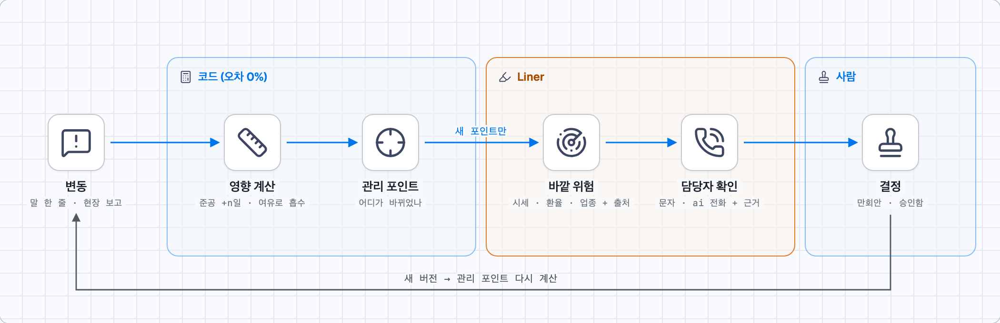
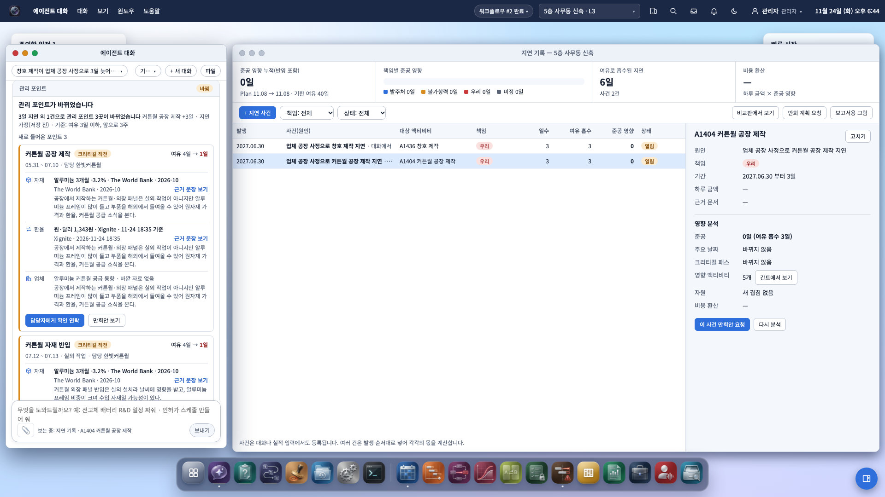
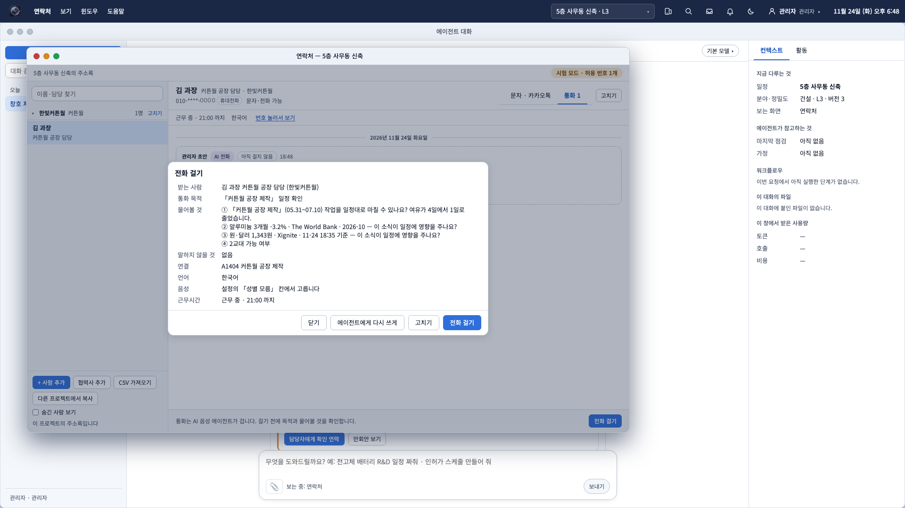
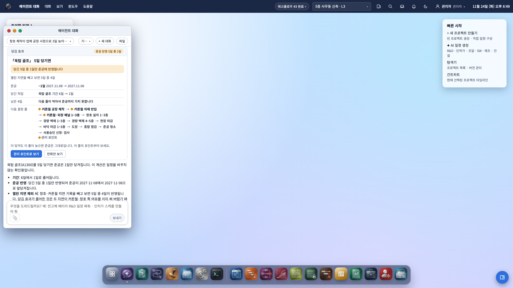
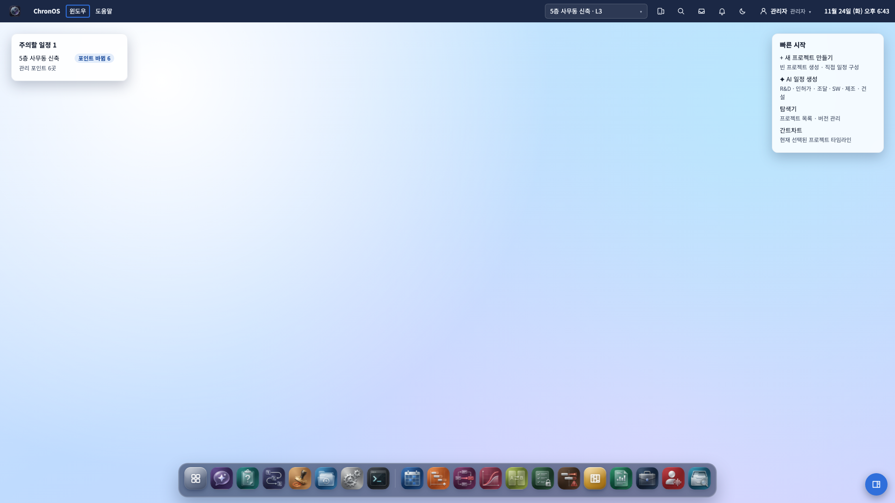
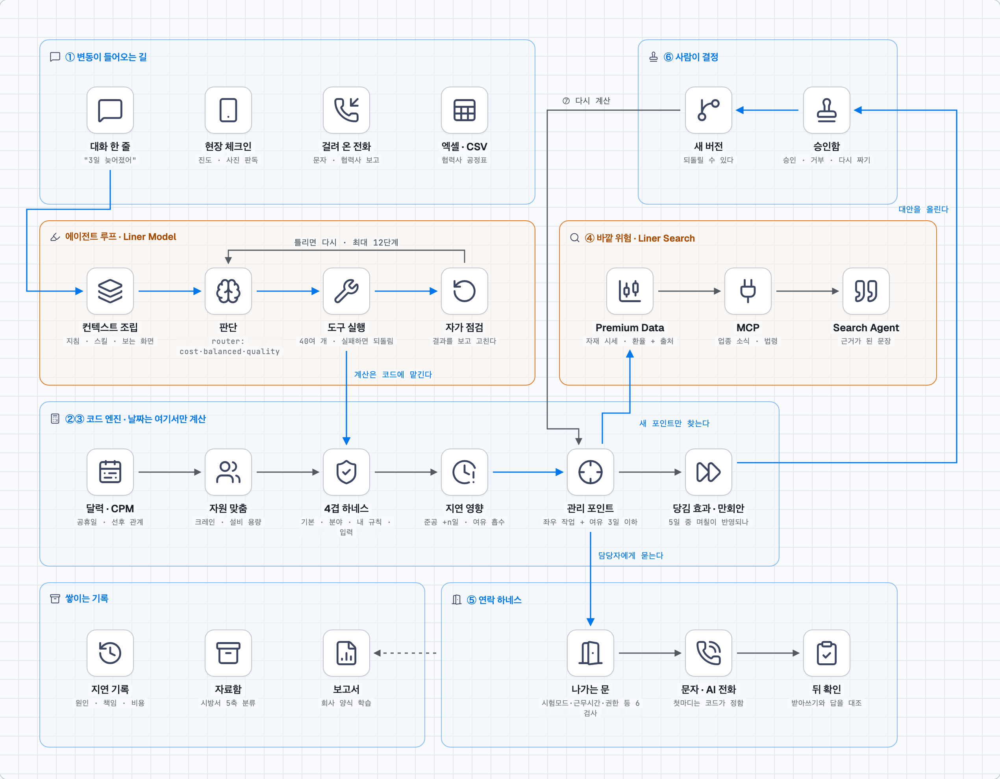
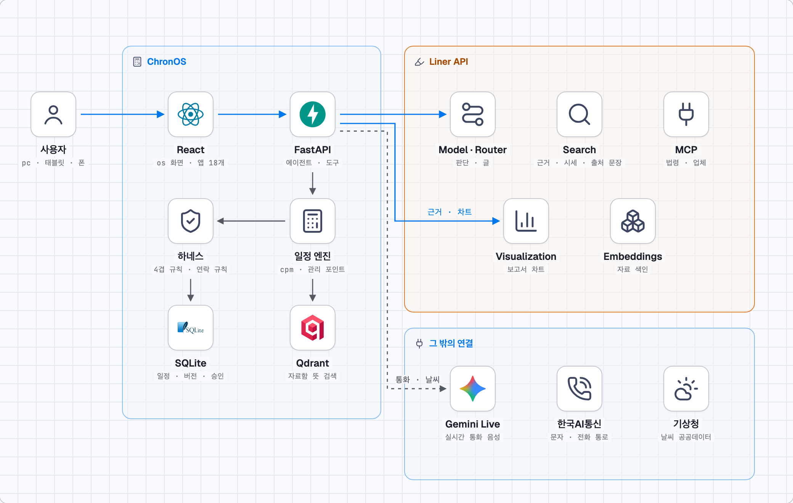
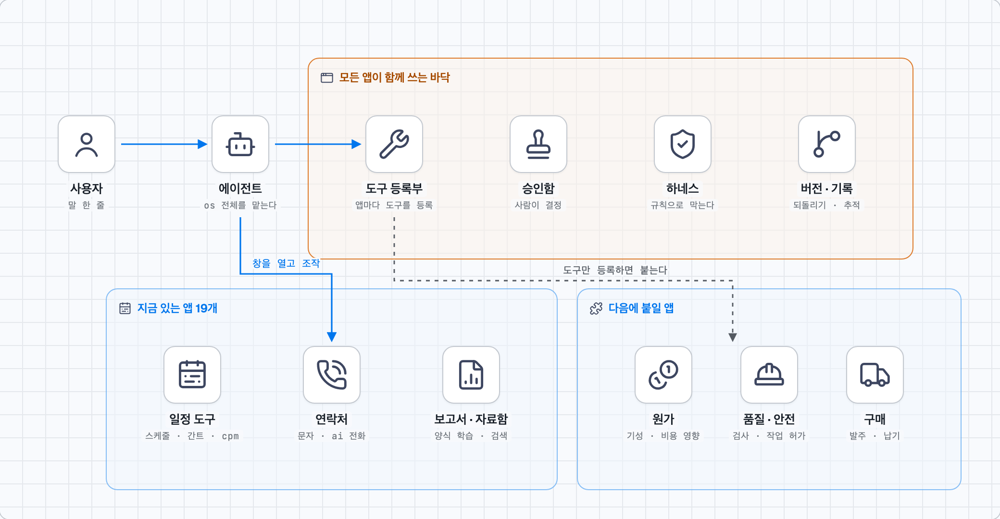

# ChronOS 기획서 rev6 (.EXE-THON 2026)

> **출품작**: ChronOS(크로노스). 일정이 바뀔 때마다 준공일을 좌우하는 작업이 어디로 옮겨 갔는지 알려 주고 그곳의 위험을 찾아 담당자에게 먼저 묻는 일정 에이전트
> **참가자**: 손장호 (개인, 건설·플랜트 PM 15년차)
> **개발 기간**: 2026-11-12 ~ 11-25 (저장소 전체 11-19 신규 작성)
> **데모 영상** 〔링크〕 · **저장소** `github.com/sohnjangho/chronos`

<!-- 표시: 〔시각 n〕 그림·화면 자리(맨 끝 제작 메모의 번호) / 〔갱신〕 제출 직전 값 / 〔실측〕 녹화 때 잰 값 / 〔PM 확인〕 PM 경험치 -->

---

## 표지

〔시각 1: 표지 그림. 왼쪽 절반은 야간 골조 현장, 오른쪽 절반은 「당긴 5일 중 1일만 준공에 반영됩니다」 카드〕

> **골조를 5일 당겼다. 준공은 하루 당겨졌다.**
> 공정이 늦어서 약속을 놓치는 것이 아니다. 준공일을 좌우하는 작업이 다른 곳으로 옮겨 간 것을 늦게 알아서 놓친다.

ChronOS 는 채팅창이 아니라 OS 다. 에이전트가 간트차트와 비교판과 승인함 창을 직접 열어 가며 일하고, 사람은 그 화면을 같이 본다. 그 위에서 15년차 PM이 변동이 생길 때마다 하던 세 가지를 대신 한다. 지금 준공일을 좌우하는 작업이 어디인지 다시 보고 당기기 전에 효과를 따지고, 그 작업의 담당자에게 먼저 묻는다.

---

## 1. 현장에서 시작한 문제

### 1-1. 내가 겪은 장면

〔시각 2: 4컷 만화 「당겨도 소용없던 밤」〕

골조가 크리티컬이었다. 야간 작업까지 넣어 골조를 앞당겨 끝냈다.

그런데 다음 외장 작업을 시작할 수 없었다. 그사이 커튼월 공장 제작이 늦어져 있었다. 준공일을 좌우하는 작업은 이미 골조에서 커튼월로 옮겨 가 있었던 것이다.

골조를 당기느라 쓴 돈과 사람은 준공을 하루도 당기지 못했다.

4,200억 원에서 3조 원 규모의 건설·플랜트 현장에서 15년 동안 일정을 맡으며 가장 자주 본 실패가 이것이다. 몰라서 생긴 실패가 아니었다. 옮겨 간 것을 늦게 알아서 생겼다.

### 1-2. 같은 3일인데 결과가 다르다

〔시각 3: 그림 「같은 3일, 다른 영향」. 같은 공정 흐름에 3일 지연 두 건. 왼쪽은 여유가 흡수하고 오른쪽은 좌우하는 작업이 바뀐다〕

일정은 약속이다. 마지막 날짜는 발주처, 고객, 팀과 맺은 약속이다.

일정은 매 순간 바뀐다. 날씨, 자재, 사람, 설비, 고객 요구가 바뀐다.

같은 3일 지연이라도 결과는 다르다. 여유가 있는 작업이 3일 늦으면 준공은 그대로다. 준공일을 좌우하는 작업이 하루 늦으면 준공도 하루 늦는다. 크기가 아니라 위치가 약속을 늦춘다.

그리고 변동이 쌓이면 좌우하는 작업 자체가 바뀐다. 어제 여유가 있던 작업이 오늘은 준공일을 쥐고 있다.

> **쉬운 용어**
> 준공일을 좌우하는 작업: 하루 늦으면 준공도 하루 늦는 작업들. 공정 관리에서는 크리티컬 패스라고 부르고 ChronOS 화면에서는 「결정 줄」로 보인다.
> 여유: 준공을 밀지 않고 늦출 수 있는 일수.
> 관리 포인트: 좌우하는 작업이거나 여유가 3일 이하인, 앞으로 3주 안의 작업. ChronOS 가 변동마다 다시 뽑는다.

### 1-3. 누가, 언제, 얼마나 불편한가

〔시각 4: 인포그래픽. 세 사람 아이콘과 각자의 숫자 하나씩〕

| 누가 | 언제 | 얼마나 |
|---|---|---|
| 공정 담당 | 지연 소식이 올 때마다 | 공정표를 손으로 다시 맞춘다. 반영은 주간 회의 때 몰아서 〔PM 확인〕 |
| PM | 만회 계획을 정할 때 | 마지막으로 본 크리티컬을 당긴다. 옮겨 갔으면 헛돈이다 〔PM 확인〕 |
| 현장 관리자 | 협력사 일정을 확인할 때 | 전화를 돌리고 내용은 남지 않는다 〔PM 확인〕 |

약속을 어기면 값이 붙는다. 공공 공사의 지체상금은 하루에 계약금액의 1천분의 0.5다(국가계약법 시행규칙 제75조). 300억 원 공사면 하루 1,500만 원이다.

### 1-4. 왜 사람도 도구도 놓치나

〔시각 5: 비교 그림. 네 칸(사람, 전문 공정 도구, 엑셀, AI 챗봇)에 ○△× 표시〕

| 해야 할 일 | 사람 | P6 등 | 엑셀 | AI 챗봇 |
|---|---|---|---|---|
| 변동마다 다시 계산 | 주간 회의 때 | ○ | × | 날짜 틀림 |
| 옮겨 간 것을 알림 | 놓침 | × | × | × |
| 그곳의 바깥 위험 | 감 | × | × | 출처 없음 |
| 담당자 확인과 기록 | 전화, 기록 없음 | × | × | × |

계산만 빠른 도구는 이미 있다. 빠져 있는 것은 계산 다음이다. 어디를 봐야 하는지 알려 주고 그곳에 무엇이 다가오는지 찾고, 담당자에게 묻는 일이다.

---

## 2. 노하우를 에이전트로

### 2-1. PM이 하던 세 가지

〔시각 6: 세 장 카드 그림. 사람 실루엣 → 화살표 → 화면 조각〕

**하나, 다시 본다.** PM은 변동이 생기면 지금 준공일을 좌우하는 작업이 어디인지 다시 본다. ChronOS 는 변동마다 영향을 재고 관리 포인트를 다시 뽑아, 바뀌었으면 카드로 알린다.

**둘, 따져 본다.** PM은 힘을 쏟기 전에 이걸 당기면 준공이 당겨지는지 따진다. ChronOS 는 「당겨도 소용 있나」로 당긴 일수 가운데 준공에 반영되는 일수를 계산해 보여 준다.

**셋, 먼저 묻는다.** PM은 그 작업의 담당자에게 먼저 묻고 들은 것을 근거로 결정한다. ChronOS 는 바깥 위험을 출처와 함께 찾고 담당자에게 문자와 AI 전화로 묻고 답마다 근거가 된 말을 남긴다. 결정은 사람이 승인함에서 한다.

### 2-2. 에이전트의 한 바퀴

〔시각 7: Stack Diagram 「한 바퀴」. 제작 완료〕

변동이 들어오면 코드가 영향을 재고 관리 포인트를 다시 뽑는다. 새로 생긴 포인트에 대해서만 Liner 가 바깥 위험을 찾고 담당자 확인을 돕는다. 사람이 결정하면 새 버전이 되고 한 바퀴가 다시 돈다.

날짜는 코드만 계산한다. Liner 는 판단하고, 찾고, 쓴다. 일정은 사람이 승인해야 바뀐다.

### 2-3. Liner 를 어디에, 왜 썼나

〔시각 8: 두 갈래 그림. 왼쪽 Liner Model(두뇌), 오른쪽 Liner Search(근거). 가운데 한 바퀴 축소판에 색으로 표시〕

**Liner Model 은 두뇌다.** 요청을 알아듣고, 질문지를 만들고, 일정 초안을 쓰고 고치고, 만회안을 설명하고, 연락 글과 통화 요약을 쓴다. 현장 사진도 읽는다. Router 전략을 일에 따라 나눠 쓴다. 감시처럼 자주 도는 일은 cost, 대화는 balanced, 만회안처럼 무거운 판단은 quality 다. 에이전트가 쉬지 않고 돌아도 비용이 버틸 수 있는 까닭이다.

**Liner Search 는 근거다.** 약속을 바꾸는 결정에는 출처가 있어야 한다. 새 관리 포인트가 생기면 그 작업의 자재 시세와 환율(Premium Data), 업종 소식(MCP), 근거가 된 문장(Search Agent)을 찾는다. 법령과 기준도 여기서 찾는다. 모든 작업이 아니라 새 포인트에만 찾으니 호출이 적다.

| | 실측 |
|---|---|
| Model·Router | 22/22회 정상(도구 호출, strict JSON) |
| Search Premium Data | 구리·알루미늄·철광석 30개월, 원·달러 (11-24) |
| Search Agent | 출처 문장과 링크 수신 (11-24) |
| MCP 법령·업체 | 5/5회 정상 |
| Visualization · Embeddings | 차트 숫자 15/15 일치 · 자료함 뜻 검색 |

Liner 가 아닌 것도 밝혀 둔다. 날짜 계산은 코드, 날씨는 기상청, 실시간 통화 음성은 Gemini Live(지연 시간 때문), 문자와 전화 통로는 한국AI통신이다.

### 2-4. 하지 않는 것

〔시각 9: 금지 표지판 모양 아이콘 여섯 개〕

- AI 가 날짜를 계산하지 않는다. AI 가 낸 날짜는 코드가 버린다.
- 자료가 없으면 숫자를 만들지 않는다. 「바깥 자료 없음」으로 둔다.
- 못 읽은 사진에 숫자를 붙이지 않는다. 관리자에게 사람 판독으로 넘긴다.
- 사람 승인 없이 일정을 바꾸지 않는다.
- 허락 없이 연락하지 않는다. 기본값은 「승인 받기」다.
- 전화번호를 AI 모델에 주지 않는다.

---

## 3. 실제로 도는 시연

시연 일정은 「5층 사무동 신축」(가상)이다. 6월 말, 준공은 2027-11-08, 계획대로 가고 있다. 지금 준공일을 좌우하는 작업은 5층 골조와 옥탑 골조다. 아래 숫자는 모두 엔진이 계산했고 자동 시험이 고정한다.

### 장면 0. 말 한 줄이 공정표 초안이 된다

〔시각 9b: 연속 화면 4장. 대화 한 줄 → 질문지 → 생성 카드(1회차 위반 → 고침 → 통과) → 간트〕

"5층 사무동 공정표 만들어 줘. 착공은 3월, 준공은 연말까지."

에이전트는 바로 그리지 않고 먼저 묻는다. 모자란 정보를 질문지로 만들어 띄우고, 답하지 않은 질문은 적어 둔 가정대로 간다. 그다음 작업 목록과 기간과 선후 관계를 쓴다. 날짜는 쓰지 않는다. 날짜는 코드가 계산하고, 계산한 결과가 규칙을 어기면(예: 동절기 타설 금지, 크레인 겹침) 어긴 작업을 지목해 다시 짜게 한다. 통과한 초안만 승인함으로 간다.

처음 보는 분야라도 된다. 용어와 작업 계층과 위험 규칙을 그 자리에서 만들어 같은 엔진에 태운다. 협력사가 보낸 엑셀 공정표를 붙이면 빈칸만 물어서 초안으로 가져온다.

### 장면 1. 같은 3일, 다른 영향

〔시각 10: 화면 두 장 나란히. 왼쪽 창호 지연 카드(변화 없음), 오른쪽 커튼월 지연 카드(포인트 이동)〕

"창호 제작이 3일 늦어졌어." 준공은 그대로고 관리 포인트도 그대로다. 창호 쪽은 여유가 18일이다.

"커튼월 공장 제작도 3일 늦어졌어." 이번에도 준공은 그대로다. 사람은 여기서 안심한다. 하지만 커튼월 쪽 여유가 4일에서 1일로 줄었고 커튼월 공장 제작과 자재 반입과 설치가 새 관리 포인트가 됐다.

### 장면 2. 관리 포인트가 바뀌었습니다

〔시각 11: 화면. 카드 부분만 잘라 크게〕

에이전트가 카드를 띄운다. 새 포인트 3건과 그곳의 바깥 위험이다. 알루미늄은 「3개월 -3.2% · World Bank」, 환율은 「원·달러 1,343원 · Xignite」 〔갱신: 촬영 시점 값〕. 업계 소식은 「알루미늄 커튼월 시장 규모 및 산업 분석」(2026-07-11) 한 줄이 출처와 함께 붙는다. 6개월이 넘은 글은 쓰지 않고, 찾지 못하면 「바깥 자료 없음」으로 둔다. 리허설에서는 실제로 그렇게 나온 적도 있다. [근거 문장 보기]를 누르면 출처가 된 보고서 문장이 열린다.

### 장면 3. 담당자에게 먼저 묻는다

〔시각 12: 화면 두 장. 전화 걸기 창과 통화 카드. 옆에 통화 말풍선 3개〕

[담당자에게 확인 연락]을 누르면 에이전트가 물어볼 것을 써 온다. 사람이 고친다. 여기서는 「2교대 가능 여부」를 더하고 말하지 않을 것에 「금액, 다른 업체」를 적었다.

> 비서: 커튼월 공장 제작이 7월 10일까지 끝나야 하는 일정인데, 제시간에 끝낼 수 있을까요?
> 김 과장: 3일 늦어졌지만 7월 10일은 맞출 수 있습니다.
> 김 과장: 그런데 2교대 하면 단가는 얼마나 올라요?
> 비서: 그 부분은 제가 말씀드릴 수 없어서, 담당자께 전달하겠습니다.

81초 통화가 끝나면 질문 넷의 답과 근거가 된 말이 통화 카드에 남는다. (시연 통화는 시험 통화 녹음이다. 실제 전화망 통화도 따로 시험해 첫 응답 약 1.1초를 확인했다.)

### 장면 4. 당겨도 소용 있나

〔시각 13: ★ 이 문서의 가장 큰 그림. 카드 부분만 잘라 한 쪽 폭으로. 「5일 중 1일」에 강조 표시〕

습관대로 묻는다. "옥탑 골조를 5일 당기면?"

> **당긴 5일 중 1일만 준공에 반영됩니다.**
> 준공 2027-11-08 → 11-06. 다음 결정 줄은 커튼월 공장 제작 → 자재 반입 → 커튼월 설치.
> 열린 지연을 빼고 보면 5일 중 4일.

같은 5일인데 커튼월이 늦어지기 전에는 4일의 값어치였고 지금은 1일이다. 1-1의 그 밤에 내가 몰랐던 것을, 에이전트는 야간 작업을 넣기 전에 알려 준다.

### 장면 5. 대안을 견주고 사람이 결정한다

〔시각 14: 화면. 비교판과 승인함〕

만회안 B 는 준공을 11-01 로 6일 당긴다. 크레인을 1대에서 2대로, 천장 마감을 15일에서 12일로, 커튼월 설치를 10일에서 8일로 줄이는 안이다. 비교판에서 다른 안과 견주고 승인함에서 사람이 승인한다. 승인하면 새 버전이 되고 에이전트는 관리 포인트를 다시 뽑는다.

### 3-1. 에이전트가 쓰는 OS

〔시각 15: ★ 연속 화면 3장(Computer Use). 대화 한 줄 → 워크플로우 창에 단계가 생기고 간트 창이 앞으로 나온다 → 비교판과 승인함이 차례로 열린다. 아래에 Dock 의 앱 19개〕

AI 에이전트는 보통 채팅창 하나다. 답이 글로 돌아오고, 사람이 그 글을 들고 다른 프로그램으로 옮겨 간다.

ChronOS 는 반대로 만들었다. 일하는 책상 전체를 OS 로 만들고 그 책상을 에이전트에게 맡겼다. "골조가 3일 늦어졌어"라고 말하면 에이전트가 스케줄 창에서 그 작업을 찾고, 지연 기록 창을 열어 영향을 계산하고, 만회안을 비교판에 띄운다. 사람은 창이 열리고 숫자가 바뀌는 것을 눈으로 따라가다가 마지막에 승인만 누른다.

이 방식을 화면 설정에서는 「스테이지 창 전환 · 포커스 추적」이라고 부른다. 컴퓨터를 사람처럼 다루는 에이전트, 곧 Computer Use 의 방식이다. 요청이 들어오면 워크플로우 창이 열려 단계가 하나씩 생기고, 단계마다 그 일을 하는 프로그램 창이 앞으로 나온다. 다만 남의 화면을 스크린샷으로 보고 마우스를 흉내 내는 방식과는 다르다. ChronOS 의 에이전트는 자기 OS 의 창을 도구(`ui.open_window`)로 정확히 연다. 그래서 빠르고, 엉뚱한 곳을 누르는 일이 없고, 현장 관리자에게 없는 창은 열지 못하는 식으로 권한도 지킨다. 조용히 쓰고 싶으면 워크플로우 창만 보이게 하거나 끌 수 있다.

〔시각 15b: 연속 화면 3장. 워크플로우 창에서 단계 그래프가 자란다(단계 1개 → 4개 → 완료). 오른쪽에 단계 상세〕

에이전트는 정해진 순서를 따라가지 않는다. 요청을 받고 그 자리에서 워크플로우를 짜면서 일한다. 워크플로우 창에는 단계가 하나씩 생긴다. 작업을 찾고, 지연을 기록하고, 영향을 계산하고, 관리 포인트를 확인하는 식이다. 단계를 누르면 어떤 도구를 왜 썼는지, 무엇을 받아 무엇을 돌려줬는지, 어느 모델이 얼마를 썼는지가 나온다. 화면 위쪽 진행 띠에도 같은 단계가 흐른다.

잘 된 워크플로우는 [스킬로 저장]한다. 다음에 비슷한 요청이 오면 에이전트가 그 순서를 꺼내 쓴다. 베테랑의 일하는 순서가 한 번 쓰고 사라지지 않고 회사에 남는다.

OS 로 만든 까닭은 셋이다.

- **보인다.** 에이전트가 무엇을 했는지 글로 설명받지 않고 화면에서 본다. 일정처럼 책임이 큰 일에서는 이것이 신뢰다.
- **같이 쓴다.** 사람이 스케줄 창에서 고른 작업을 에이전트도 본다("보는 중: 스케줄 · A1210"). 사람이 직접 고쳐도 되고 에이전트에게 시켜도 된다. 같은 창이다.
- **붙는다.** 앱 19개가 승인함, 하네스, 버전, 도구 등록부를 함께 쓴다. 새 앱은 폴더 하나와 도구 등록으로 붙고, 붙는 순간 에이전트가 쓸 수 있다(4-3).

| 묶음 | 앱 |
|---|---|
| 시스템 | 에이전트 대화, 질문지, 워크플로우, 승인함, 탐색기, 설정, 개발 콘솔 |
| 일정 | 스케줄, 간트차트, CPM, 공정률과 현장 점검, 관리 포인트, 비교판, 조건·규칙, 지연 기록, 보고서 |
| 연결 | 프로젝트 관리, 연락처(문자, AI 전화), 자료함 |

PC 에서는 창을 여러 개 띄우고, 태블릿은 좌우로 나누고, 스마트폰은 아래 탭으로 쓴다. 말 한 줄로 공정표를 만들고, 협력사 엑셀을 붙이면 빈칸만 물어 가져오고, 월간 보고서는 회사 양식을 배워서 쓴다.

### 3-2. 구조

변동 하나가 들어와 결정이 되기까지 에이전트 안에서 일어나는 일이다.

〔시각 16a: Stack Diagram 「에이전트 로직」. 제작 완료. 한 쪽 전체 폭〕

에이전트 루프는 틀리면 다시 돈다(최대 12단계). 날짜가 필요한 순간마다 코드 엔진에 맡기고, 엔진은 4겹 하네스로 규칙을 확인한다. 관리 포인트가 새로 생기면 그 작업에 대해서만 Liner Search 가 움직인다. 연락은 여섯 가지 검사를 통과해야 나가고, 통화가 끝나면 받아쓰기와 답을 대조한다.

〔시각 16b: Stack Diagram 「구조도」. 제작 완료〕

### 3-3. 만든 것과 설계만 된 것

〔갱신: 2026-11-25 기준〕

| 영역 | 동작함 | 설계만 |
|---|---|---|
| 일정 엔진 | CPM, 자원 맞춤, 지연 영향, 만회안, 관리 포인트, 당김 효과 | - |
| 에이전트 | 질문지, 생성-점검-고침, 스킬 저장, 도구 40여 개 | 스킬 목록 화면 |
| 안전장치 | 4겹 하네스, 승인함, 버전, 연락 하네스 | 팀 단위 세부 권한 |
| 근거 | 자료함, Liner 검색, 바깥 위험, 출처 문장 | 스캔 PDF 인식 |
| 현장·연락 | 현장 점검, 문자, AI 전화 걸기와 받기 | 카카오 알림톡 실발송 |
| 가져오기·보고 | 엑셀·CSV, 월간·분기 보고서 | P6·MS Project 변환 |

### 3-4. 검증

〔시각 17: 숫자 띠. 큰 숫자 네 개〕

서버 시험 〔갱신〕건과 화면 시험 〔갱신〕건을 통과했다. 실제 Liner 로 46단계 업무 시나리오를 돌렸고 시연 장면은 두 번 리허설했다. 실제 전화망 통화는 첫 응답 약 1.1초였다. 사진 판독은 공개 라이선스 현장 사진 10장으로 두 모델을 견줘, 숫자를 지어내지 않는 쪽을 골랐다.

---

## 4. 어디까지 넓어지나

### 4-1. 시간과 비용

〔시각 18: 전후 비교 막대. 「주간 회의(최대 7일) → 변동 직후」, 「당긴 뒤에 안다 → 당기기 전에 안다」〕

| | 지금 | ChronOS |
|---|---|---|
| 옮겨 간 것을 아는 때 | 주간 회의 〔PM 확인〕 | 변동 직후 〔실측〕 |
| 헛수고가 될 가속 | 당긴 뒤에 안다 | 당기기 전에 「5일 중 1일」 |
| 담당자 확인 | 전화, 기록 없음 | 81초 통화, 답마다 근거 |

300억 원 공사에서 하루는 지체상금으로 1,500만 원이다. 옮겨 간 것을 일주일 일찍 알면 그 일주일 동안 싸게 쓸 수 있는 방법이 아직 남아 있다.

### 4-2. 건설과 생산 말고도

〔시각 19: 분야 지도. 가운데 「약속 + 변동 + 좌우하는 작업」, 둘레에 분야 아이콘 열두 개〕

약속이 있고, 작업이 서로 이어져 있고 변동이 잦은 일이면 구조가 같다. 엔진과 한 바퀴는 그대로 쓰고 분야마다 볼 바깥 자료만 설정에서 켜고 끈다. 건설과 생산은 분야 묶음을 만들어 시연까지 했다. 나머지는 처음 보는 분야의 묶음(용어, 작업 계층, 위험 규칙)을 즉석에서 합성하는 기능으로 받는다.

| 분야 | 약속 | 준공일을 좌우하기 쉬운 것 |
|---|---|---|
| 건설 (시연) | 준공일 | 골조, 외장, 장납기 자재 |
| 생산 (시연) | 납기 | 금형, 설비 보수, 원자재 |
| 플랜트 정기 보수 | 재가동일 | 장납기 부품, 검사, 크레인 |
| 조선·해양 | 인도일 | 블록 탑재, 기자재 입고 |
| 반도체·배터리 라인 셋업 | 양산 시작일 | 장비 반입, 유틸리티, 인증 |
| 신제품 개발 | 출시일 | 시제품, 인증 시험, 금형 |
| 연구과제 | 평가·보고 기한 | 시험 장비 예약, 시료, 심의 |
| 인허가·사업화 | 영업 개시일 | 심의 일정, 보완 요구 |
| IT 시스템 구축 | 오픈일 | 데이터 이관, 연동, 검수 |
| 행사·전시 | 개막일 | 대관, 시공, 운송 |
| 매장 출점 | 오픈일 | 인테리어, 인허가, 집기 납품 |
| 영상·콘텐츠 제작 | 공개일 | 촬영 일정, 후반 작업, 심의 |

참가자가 직접 겪은 분야도 여기 있다. 사우디 SRU 정기 보수, 대전 파일럿 플랜트 구축, 해외 플랜트 배관이 그것이다.

### 4-3. OS 라서 붙일 수 있다

〔시각 19b: Stack Diagram 「OS 확장」. 제작 완료〕

일정은 시작일 뿐이다. 현장의 일은 일정 하나로 끝나지 않는다. 늦어지면 돈이 달라지고, 검사 날짜가 밀리고, 발주를 당겨야 한다.

OS 로 만들었기 때문에 이런 도구를 같은 책상에 앱으로 붙일 수 있다. 원가 앱을 붙이면 "이 만회안은 얼마가 더 드나"를 같은 대화에서 묻는다. 품질·안전 앱을 붙이면 관리 포인트 작업의 검사와 작업 허가를 함께 본다. 구매 앱을 붙이면 장납기 자재의 발주와 납기가 관리 포인트에 이어진다.

새 앱은 승인함과 하네스와 버전을 처음부터 물려받는다. 에이전트는 새 도구를 등록부에서 읽고 바로 쓴다. 에이전트가 똑똑해질수록, 앱이 늘어날수록 한 사람이 맡을 수 있는 일의 폭이 넓어진다.

### 4-4. 다른 조직과 직무로

- 중소 시공사와 협력사. 비싼 공정 도구 없이 대화 한 줄로 시작한다.
- 앱을 쓰지 않는 사람. 협력사 담당자는 문자와 AI 전화로 한 바퀴에 들어온다. 여러 언어로 통화한다.
- 발주처와 감리. 승인 기록, 버전, 통화 근거가 그대로 보고 자료가 된다.
- 구매, 품질, 안전. 같은 관리 포인트에 납기 확인, 검사 일정, 작업 허가를 붙일 수 있다.

### 4-5. 알려진 한계

- 실제 현장 운영 검증 전이다. 시연 숫자는 가상 일정에서 엔진이 낸 값이다.
- 국내 철근·시멘트 단가는 Liner Premium Data 에 없어 국제 금속 시세로 대신한다.
- 실시간 통화 음성은 Gemini Live 를 쓴다. 카카오 알림톡은 연결만 있다.

---

## 5. 만든 사람과 규정

〔시각 20: 경력 띠. 현장 네 곳을 연도와 함께〕

**손장호**, 건설·플랜트 PM 15년차. SK온 대전 파일럿 플랜트(4,200억) PM 총괄, 쿠웨이트 NWC(3,000억) Part Leader, UAE RRE#2(3조) 배관 엔지니어, 사우디 SRU TA(2,000억) 기계. 공정표로 판단해 온 사람이 직접 만들었다.

- Liner API 핵심 사용(제4조 1항): 한 바퀴의 판단에 Liner Model, 근거에 Liner Search 를 쓴다.
- 기간 내 신규(제4조 2항): 11-19 새 저장소에서 처음부터 만들었다.
- 가상 데이터(제5조): 일정, 계정, 협력사, 주소록은 가상이고 사진은 공개 라이선스 자료다. 시연 통화는 시험 통화 녹음이며 실제 번호로 걸지 않았다.
- 보안: API 키는 암호화해 저장하고 끝 4자리만 보인다. 전화번호와 키는 로그에 남기지 않는다. 커밋 이력 비밀 검사 통과 〔갱신〕.

---

## 부록 A. 기술 구조 (개발자 심사용)

- 일정 엔진 `backend/app/core/`
  - `calendar.py` 근무일 배열과 이분 탐색으로 공휴일과 금지 기간을 반영한다.
  - `cpm.py` 위상 정렬로 순환을 막고 FS/SS/FF/SF + lag, 전진·후진 패스로 ES/EF/LS/LF, TF/FF를 낸다.
  - `resources.py` 일일 용량을 넘지 않는 시작 자리를 찾아 후행으로 전파한다.
  - `shorten.py` 병행, 압축, 자원 추가를 한 수씩 넣고 다시 계산해 만회안을 만든다.
  - `delay.py` 지연 전후를 비교해 새로 크리티컬이 된 작업과 새 자원 겹침을 낸다.
  - `points.py`, `accel.py` 관리 포인트와 당김 효과 〔갱신: 최종 이름〕
- 4겹 하네스 `backend/app/harness/`: 기본 < 분야 < 내 규칙 < 입력 순으로 경합을 판정한다.
- 에이전트 `backend/app/agent/`: ReAct 루프, 도구 실행 전 커밋과 실패 시 되돌림, 자가 점검, 스킬 매칭.
- 연락 `backend/app/outreach/`: 나가는 문(시험 모드 → 차단 → 근무시간 → 상한 → 권한 → 중복), 들어오는 문(번호로 등급), 통화 하네스.
- 화면 `frontend/src/`: React OS 셸, 앱 19개, PC·태블릿·폰.

---
---

# 제작 메모 (제출본에서는 뺀다)

## A. 「와우」 지점

| 순위 | 어디 | 무엇 | 왜 |
|---|---|---|---|
| 1 | 3-1 (시각 15) | 에이전트가 OS 의 창을 직접 열어 가며 일하는 연속 화면 | Computer Use 방식으로 창이 차례로 앞으로 나오고, 워크플로우 창에서 에이전트가 짜는 단계가 실시간으로 자란다. 채팅창 에이전트와 한눈에 다르다. 영상에서는 첫 화면부터 보인다. 확장성(4-3)의 근거이기도 하다 |
| 2 | 장면 4 (시각 13) | 「당긴 5일 중 1일만 준공에 반영됩니다」 카드 | 1-1 의 실패를 숫자 하나로 뒤집는다. 표지 문장과 같은 숫자라 처음과 끝이 이어진다 |
| 3 | 장면 3 (시각 12) | AI 가 협력사에 문자를 보내고 전화를 걸어 일정을 묻고 답을 받아 온다. 걸려 온 전화도 받는다 | 에이전트가 화면 밖의 사람과 직접 상호작용한다. 답마다 근거가 남고, 금액처럼 범위 밖 질문은 거절한다 |
| 4 | 장면 0 (시각 9b) | 말 한 줄이 공정표 초안이 된다. 질문지 → 초안 → 코드 계산 → 규칙 위반 → 고침 → 통과가 화면에서 차례로 보인다 | 누구나 바로 이해하는 장면이다. AI 가 틀린 초안을 코드가 잡아 다시 짜게 하는 과정이 보여서 신뢰도 함께 준다 |

표지에서 OS 화면과 「5일 중 1일」을 함께 미리 보여 주고(「5일 당겼다, 하루 당겨졌다」), 본문 한가운데에서 실제 화면으로 터뜨린다.

## B. 시각 자료 배치

| # | 자리 | 종류 | 상태 |
|---|---|---|---|
| 1 | 표지 | 합성 그림(현장 + 카드) | 만들어야 함. 카드 화면은 있음 |
| 2 | 1-1 | 4컷 만화 「당겨도 소용없던 밤」 | **새로 그려야 함**(아래 C) |
| 3 | 1-2 | 그림 「같은 3일, 다른 영향」 | 내가 SVG 로 그림 |
| 4 | 1-3 | 인포그래픽(세 사람, 숫자) | PM 확인 값 받은 뒤 |
| 5 | 1-4 | ○△× 비교 그림 | 표를 그림으로 |
| 6 | 2-1 | 노하우 세 장 카드 | 내가 그림 |
| 7 | 2-2 | Stack Diagram 한 바퀴 | **완료** `assets/rev6/d1-한바퀴.png` |
| 8 | 2-3 | Model / Search 두 갈래 | Stack Diagram 으로 추가 제작 |
| 9 | 2-4 | 금지 아이콘 여섯 | 내가 그림 |
| 9b | 장면 0 ★ | 연속 화면 4장(질문지 → 생성 카드 → 간트) | 화면 녹화 S2 에서 스틸로 뽑기 |
| 10 | 장면 1 | 화면 2장 | 리허설 사진 있음(잘라 쓰기) |
| 11 | 장면 2 | 화면(카드 확대) | 있음 `s2-바깥위험.png` |
| 12 | 장면 3 | 화면 2장 + 말풍선 | 있음 `s4-전화걸기창.png`, 통화 카드는 녹화 스틸 |
| 13 | 장면 4 ★ | 화면(카드 확대, 한 쪽 폭) | 있음 `s5-당겨도소용있나.png` |
| 14 | 장면 5 | 비교판, 승인함 | 녹화 뒤 스틸 |
| 15 | 3-1 ★ | 연속 화면 3장(에이전트가 창을 여는 모습) | 녹화 영상에서 스틸로 뽑기. 바탕화면은 있음 |
| 15b | 3-1 ★ | 연속 화면 3장(워크플로우 단계 그래프가 자라는 모습) + 단계 상세 | 화면 녹화에서 스틸로 뽑기 |
| 16a | 3-2 | Stack Diagram 에이전트 로직(25칸) | **완료** `assets/rev6/d3-에이전트로직.png` |
| 16b | 3-2 | Stack Diagram 구조도 | **완료** `assets/rev6/d2-구조도.png` |
| 19b | 4-3 | Stack Diagram OS 확장 | **완료** `assets/rev6/d4-OS확장.png` |
| 17 | 3-4 | 숫자 띠 | 제출 직전 값 |
| 18 | 4-1 | 전후 막대 | 실측 뒤 |
| 19 | 4-2 | 분야 지도(열두 분야) | 내가 그림 |
| 20 | 5 | 경력 띠 | 내가 그림 |

화면 사진은 바탕화면 전체가 아니라 카드 부분만 잘라 크게 넣는다. 지금 사진은 창이 작아 글씨가 안 읽힌다.

## C. 만화와 실사 사진

- 이전 기획서의 4컷(`comic-before.jpg`: 비 오는 현장 전화, 밤샘, 회의 충돌, 질책)은 「밤새 다시 계산」 이야기라 새 이야기와 맞지 않는다. 그림체는 좋으니 같은 그림체로 **새 4컷**이 필요하다.
  1. 간트 앞에서 PM이 빨간 골조 줄을 가리킨다. "골조가 크리티컬이야. 당기자."
  2. 야간 골조 현장. 조명과 크레인, 지친 작업자들.
  3. 골조가 끝난 건물. 외벽은 비어 있고 PM이 전화를 든다. "커튼월이 아직 안 왔다고요?"
  4. 간트에서 빨간 줄이 커튼월 쪽으로 옮겨 가 있다. 달력의 준공일은 그대로. PM의 표정.
- 뒤쪽 짝 4컷(선택): 같은 PM, 같은 상황에서 ChronOS 카드 「5일 중 1일」을 보고 골조 대신 커튼월 업체에 전화하는 장면. 4-1 옆에 둔다.
- 그림 생성은 PM이 쓰신 도구로 해야 한다(이 세션에서는 그림 생성 불가). 위 장면 설명을 프롬프트로 다듬어 드릴 수 있다.
- 실사 사진: 사진 판독 비교에 쓴 공개 라이선스 현장 사진 10장(`…/plan-5-points/vision/`, 출처·라이선스 기록 있음)에서 커튼월 설치와 골조 사진을 1-1 배경이나 표지에 쓸 수 있다. 출처 표기를 붙인다.

## D. 남은 값

〔PM 확인〕 3곳(공정표 반영 주기, 야간 작업 하루 비용, 하루 확인 전화 수), 〔갱신〕 시험 건수와 촬영 시점 값, 〔실측〕 변동 입력부터 카드까지 걸린 시간.
